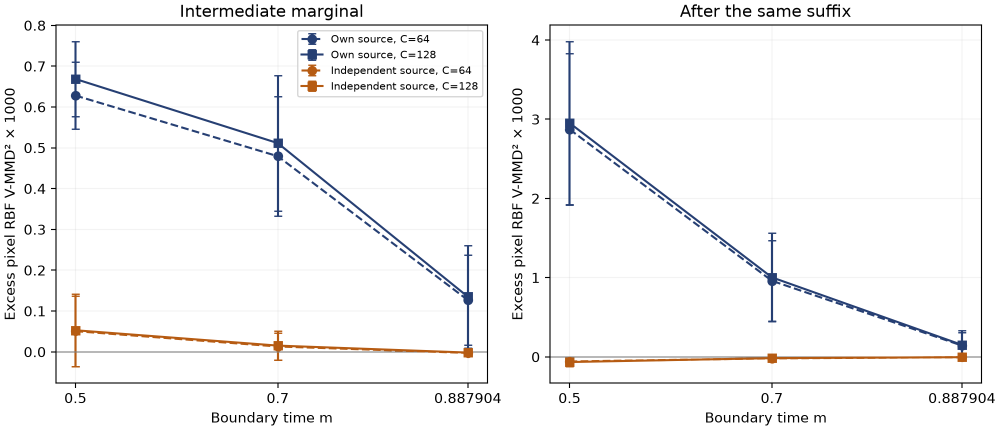

# 真实模型中间路径验证与原创贡献核查

日期为2026年11月3日，基准提交05f608dd3d245fdf7c213734359e3edff069f02a。新增证据把逐样本轨迹接近与中间边缘相容区分开：在一个真实CIFAR-10 1RF检查点上，保留原噪声的弦线比独立噪声弦线更贴近样本轨迹，却在预定主时刻呈现更高的中间和接续终点分布差异。本轮没有得到新采样算法或总体质量收益，原创充分性仍待评估。

## 实验对象与固定协议

冻结与第V-E节相同的CIFAR-10 1RF EMA检查点，使用新生成种子201/202/203。每种子从先验生成两组各128条轨迹：A组用于干预，独立B组提供分布参照。同一初值在64与128次调用两档下重复使用；物理时间结点固定为0、0.5、0.7、0.7^(1/3)、1，粗档分段步数为[32,13,12,7]，细档逐段加倍。Euler增量使用实际dt，状态不裁剪。本诊断从物理时间0开始，区别于旧质量实验的epsilon时间约定，不作旧分数的直接复现。

在各时刻m，对A组分别采用数值真实状态、mX₁+(1−m)Z₀及mX₁+(1−m)Z′作为后段初值，其中Z₀是同条轨迹原始噪声，Z′为独立高斯噪声。所有臂使用同一冻结模型和同一后段网格。真实状态重放是软件正控制。两种弦线比较只更换边界输入；它们不是与历史完整采样器等总调用的质量比赛。

主时刻预定为m=0.7，其他两时刻为固定对照。主读数为3072维未裁剪像素上的高斯RBF经验V-MMD²，k(x,y)=exp(−||x−y||²/(2d))，d=3072（Gretton等，2012）。分别比较干预A组对B组、真实A组对B组；两者之差称超额差异，仅是同规模有限样本参照，不是总体偏差扣除或无偏校正。另报未截零的U-MMD²、预定带宽0.5/2倍、归一化经验Hungarian-W₂及配对RMS。配对距离和经验W₂不替代总体W₂，也不把核距离称为FID/KID或感知质量。全部36个干预单元、18个重放控制及数值精度敏感性完整报告，不作显著性或普遍机制声明。

环境为服务器flowmol3_venv，Python3.12.13、Torch2.7.0+cu128，物理GPU0为RTX PRO 6000 Blackwell。权重SHA-256为c29936c219f34800131c07b81a8da4862b0c0b6f4e5e50efea267d24eef1f2ec，沿用已核对官方EMA及前向一致性的检查点与加载器。相同训练权重并非多个独立训练重复。所有新实验配置均在任何真实模型生成前保存在本地协议文件；CPU单元测试先行，未进行公共预注册。

## 观察结果

36个干预单元和18个重放控制全部完成，跳过0。数值真实状态接续后的最大元素误差为0，这是同一离散网格的实现一致性检查，不是精确ODE正确性的独立证明。两档轨迹中间/终点状态的配对RMS差异范围为0.011090—0.036881，因此细档也不称无离散误差的真实分布。

在预定主时刻m=0.7，128步分辨率下，原噪声弦线的中间/终点超额MMD²均值分别为+0.00051143/+0.00100336；独立噪声弦线为+0.00001520/-0.00001682。原噪声弦线的边界配对RMS约0.062889，反而小于独立噪声弦线的0.408079。主时刻原噪声弦线的中间和终点超额主指标在六个种子—精度单元均为正；独立噪声弦线则在有限样本参照附近变化，包含正负值。独立臂接近参照不能证明严格目标保持或统计等效。

| m | 边界状态 | 中间超额MMD² ×10³ | 终点超额MMD² ×10³ | 边界配对RMS |
|---|---|---|---|---|
| 0.500000 | 原噪声弦线 | +0.6686 ± 0.0920 | +2.9521 ± 1.0298 | 0.072820 |
| 0.500000 | 独立噪声弦线 | +0.0528 ± 0.0889 | -0.0660 ± 0.0565 | 0.690839 |
| 0.700000 | 原噪声弦线 | +0.5114 ± 0.1660 | +1.0034 ± 0.5579 | 0.062889 |
| 0.700000 | 独立噪声弦线 | +0.0152 ± 0.0355 | -0.0168 ± 0.0201 | 0.408079 |
| 0.887904 | 原噪声弦线 | +0.1349 ± 0.1259 | +0.1508 ± 0.1842 | 0.036558 |
| 0.887904 | 独立噪声弦线 | -0.0019 ± 0.0013 | -0.0048 ± 0.0027 | 0.147714 |

细档结果为三种子均值±一个种子间样本标准差，非置信区间。全36单元CSV与JSON包括不利和负的超额读数，未按结果挑选时间、种子或核带宽。

原噪声臂在主时刻的中间/终点超额MMD²于两精度、三种子均为正；三种预定带宽下，原噪声臂减独立臂均为正。归一化经验W₂呈现相同方向，原噪声臂较真实A对B的中间RMS距离高约0.029—0.032，接续终点高约0.053—0.056。独立臂在有限样本参照附近，不能据此主张严格不变性、等效、总体W₂证书或质量改善。

## 解释与可证伪边界

配对RMS衡量某条轨迹的移动，MMD比较整体边缘；二者的对象不同。独立训练路径在理想情形允许新独立噪声重建正确中间边缘，并不要求每条学习轨迹是直线。一个经典高斯校准已经体现这种区别：先验和目标均为N(0,1)，真实中间标准差qₘ=√(m²+(1−m)²)。m=0.5时，原噪声弦线配对RMS为0.292893，小于独立弦线的0.541196；但前者接续输出方差为2，后者为1。该解析校准不是新定理，逐时刻数值另有JSON记录。

新增真实模型数据与上述对象区分一致，不能把凸梯度直线路径的刷新障碍直接移用于独立训练的1RF，也不能据本轮单边界、无质心、物理时间诊断追认旧四轮CIFAR质量退化的原因。若未来外部模型上的预定诊断不能区分结果，或诊断指导动作没有匹配总调用的质量收益，应拒绝更强的机制和算法贡献主张。当前完成的是同一冻结模型下替换边界状态的受控干预，不是前瞻性诊断选择或外部泛化试验。

## 原创贡献与已有工作的对应

| 对象 | 已有基础 | 本轮增量与尚缺证据 |
|---|---|---|
| 再噪声后继续流映射 | Diamond Maps、Restart已有直接操作 | 不作为独有算法；未取得新质量优势 |
| 凸梯度成本差与传播界 | 经典OT、Bregman与Lipschitz推前 | 保留条件推导，不作为独有数学工具 |
| 端点不可区分构造 | 随机插值已有路径自由度 | 指定刷新核的显式反例；充分新颖性仍待逐命题评估 |
| 中间边缘匹配 | CMM已有累计边缘训练目标 | 冻结检查点边界替换与训练蒸馏不同；关注边缘本身不是首次 |
| 修正后的部署状态 | CorrFlow训练表征残差修正器并分析部署分布 | 本轮不训练修正器，只检验固定边界状态；未作共同基准优越性比较 |
| 路径接近与边缘相容 | RF及核双样本理论已有基础 | 新增真实模型三种子、双精度、同后段干预证据；尚缺训练重复、独立模型和可部署决策 |

CMM与CorrFlow均为2026年预印本，未视作同行评议定论。按现有证据，最稳妥的贡献表述是：围绕固定端点边界核给出条件与反例，并以真实模型验证逐样本接近不足以判定边缘相容。不使用“首次提出中间边缘诊断”“刷新必然有害”或“已达到硬一区标准”的表述。SC-04/05仍保留EVIDENCE_GAP，SC-41仍需修订；不以完成实验自动抬高新颖性状态。

## 运行故障与预算记录

首次运行已完成首种子粗档，写索引时因相对路径对绝对根目录调用relative_to而失败。原脚本、日志、协议、已生成原始文件均保留，未纳入科学分析。修复仅涉及索引路径解析及正确记录外层时限，数学、网格、种子、指标不变；新目录重新执行全部单元，无择优复用。失败耗时37.780690秒、成功重跑161.458738秒，合计199.239428秒GPU承载进程墙钟。保守核算分别计40和480秒，既有6638秒加本轮520秒为7158/7200秒；原失败记录的500秒是未耗尽的硬上限预留，释放说明与原记录一并留存，不将失败时间抹去。此后分析全部使用CPU，耗时2.506992秒，跳过0。

## 文稿 证据与后续验收

中文v9新增协议V-I、结果VI-L、图10和表XV，修正讨论与结论；旧20个表格对象与9幅图保留，科学数值不改。共21个表格对象、20张编号表、10幅图、35条文献。正式英文篇幅和匿名材料仍待编排。完整45项自查表保留历史；本轮真实干预不抵扣独立原创性或外部验证缺口。

协议、元数据、逐单元分数、逐批实际调用、故障说明、保守预算和完整原始数据摘要见本轮版本化材料。大型原始快照保留在研究服务器，并在代码和记录经GitHub同步后另存Mac以便CPU复算，不把文件存在称为全部科学假设成立。4项聚焦测试、24项项目检查和72个回归向量的结果以CHECKS.json为准，包含历史非致命警告。

## 原始来源

CMM的定义与累计边缘目标见https://arxiv.org/html/2610.34575 ，版本v2、2026年10月30日。CorrFlow的残差修正与部署分析见https://arxiv.org/html/2610.24750 ，版本v1、2026年10月17日。核双样本统计来源为https://www.jmlr.org/papers/v13/gretton12a.html 。RF原作者对训练插值与模型轨迹边缘的说明见https://www.cs.utexas.edu/~lqiang/rectflow/html/intro.html 。上述来源于本轮直接读取，用于界定方法归属，不从未发现相同句式推断首次性。
