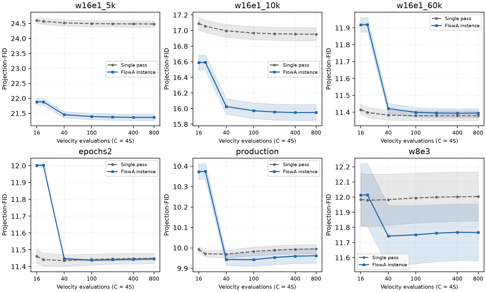
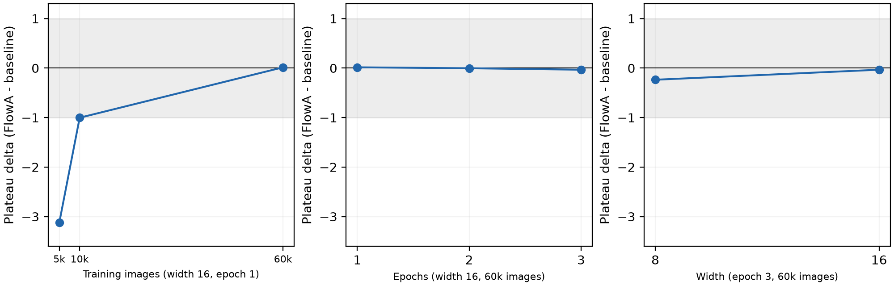

# FlowA：面向冻结流匹配检查点的轮次边界再推理

中文修订稿 v2｜TNNLS Full Paper 写作稿｜2026-11-02

本版根据源代码、六检查点结果及审稿自查表重组。新增内容包括主实验的完整操作定义、真实函数评估口径、受控检查点分析、经验诊断以及修正后的回归区间。中文稿用于讨论，正式投稿需完成英文转换、官方模板排版及剩余引文与材料核对。

## 摘要

冻结流匹配检查点的推理通常由从先验到终点的一次积分完成。本文研究在模型参数不变时，如何通过轮次边界上的状态重构改变生成结果。FlowA 将记忆、新先验、重启时间和预算分配组织为可替换的再推理过程。其 MNIST 实验实例采用受限轮数、部分时间区间再积分和最终样本质心保持，调度预算预先确定。我们以六个检查点的匹配积分预算曲线检验该实例：在 w16e1_5k 上，投影特征 Fréchet 指标的平台由 24.4839 降至 21.3632，相对改善 12.75%；其余五个检查点在既定绝对阈值规则下持平。固定架构的数据规模轴、固定数据的训练轮数轴和同训练步数的宽度对照进一步界定了收益范围。经验协方差收缩比与有限样本回归提供家族内描述，固定输入收缩与线性混合恒等式提供有条件的数学解释。跨域记录呈现蛋白代理指标点改善，也揭示未显著结果与新颖性下降。结果支持按检查点验证轮次边界干预，并区分算法实例、统计证据与可复用实现。

关键词：流匹配；生成模型；推理时控制；再推理；可复现性。

## I. 引言

流匹配通过拟合随时间变化的速度场，将简单先验输运至数据分布；整流流关注使这种输运更直接的学习过程[1]–[2]。对于已经训练完成的检查点，模型参数固定，但推理协议仍包含若干选择：积分器、时间网格、初值、重启方式与最终输出处理。这些选择共同决定实际生成的样本分布，因此“检查点相同”并不意味着“采样过程相同”。

单次积分的一个限制是，增加数值步数主要改进对既定流映射的近似。当质量随步数趋于稳定时，继续加密同一轨迹并不能保证突破该协议的质量平台。另一方面，改变下一轮初值和积分区间会引入新的状态演化，也可能带来分布偏移或多样性损失。本文的问题是：在冻结检查点和相同模型调用成本下，轮次边界干预能否形成可重复的质量收益，其适用条件是什么？

这一问题与生成过程中的重启采样直接相关。既有 Restart 方法已经把随机扰动与后续 ODE 演化结合起来[3]。本文不把重新注入噪声、重复积分或线性混合本身视为新的概念。我们关注的是一个明确的流匹配再推理实例，以及支持不同实例接入与复核的实现边界。算法的新颖性应由具体操作组合和对照证明，而不能由接口数量或工程检查数量代替。

FlowA 将终点记忆、新先验、重启时间和轮次预算分开。通用实现能够表达多种调度与反馈策略；本文最完整的 MNIST 实证对应其中一个具体实例：总积分预算分摊、累计噪声比例固定、后续轮次从记忆对应时刻积分、输出端保持首轮终点的样本质心。该实验中的调度预算在生成前计算，不能据调度器名称将其称为已验证的在线自适应反馈。本文围绕这一实例组织主结果，再把其他任务作为不同适配条件下的扩展证据。

检查点比较也采用可解释的轴。六个已有检查点覆盖固定架构的一轮训练数据规模变化、固定架构和数据的训练轮数变化，以及相同训练步数下的宽度变化。它们比简单的四点横截面提供更多结构，但仍不等于对速度场误差的直接因果测量。我们同时报告事先假设中未满足的严格单调性条件，避免用一个拟合系数替代完整检验。

本文贡献分为三个层次。第一，给出可执行的轮次边界再推理定义，明确主实验实际使用的初值、时间区间、预算和样本级后处理。第二，以六检查点的匹配预算前沿及受控轴分析界定质量收益，并将经验协方差诊断与条件性数学性质联系但不等同。第三，以清楚区分任务和比较臂的跨域结果，以及可追溯的实现记录，展示该控制面的可复用性。完整前沿优势仍限于一个 MNIST 检查点；跨域点改善不承担普遍加速或普遍质量保证。

## II. 相关工作与评价对象

### A. 单轨迹求解、训练改变与重启

流匹配和整流流提供了学习连续输运的训练框架[1]–[2]。在推理阶段，数值求解器改变对既定动力学的近似方式。以扩散模型的 DPM-Solver 为例，其重点是利用模型方程结构减少求解成本[4]；这与重新构造一个轮次的初值是不同的干预。本文没有在所有模型上复现这些专用求解器，因此这里只比较干预对象，不将设计层面的差异写成数值优越性。

训练阶段的路径改变与蒸馏则作用于检查点本身。整流流的 reflow 重新学习输运，一致性模型学习跨轨迹时刻的映射，以支持少步生成[2],[5]。本文固定速度场，不通过新的训练获得再推理收益。保持权重不变是一项协议约束，不能据此推出对训练或蒸馏方案的总体效率优势，因为总训练成本与部署需求并未在同一实验中比较。

生成过程中的随机性和重启具有更直接的相关性。基于随机微分方程的生成建模统一了不同噪声演化与校正方式[6]；Restart 在额外前向扰动与后续 ODE 采样之间交替[3]。FlowA 的 MNIST 实例采用前一轮终点和新先验的混合，并令混合比例关联重启时间。它还包含特定预算安排和样本质心处理。没有把这些操作逐项隔离的对照时，本文只能报告完整实例的效果，不能断言某一个新增环节是优势的唯一来源。

| 比较对象 | 主要改变 | 是否改变检查点权重 | 本文能够作出的比较 |
|---|---|---|---|
| 单次流匹配 / 整流流积分 | 从一次先验完成输运 | 推理时不变 | 同检查点的直接基线 |
| 数值求解器 | 单轨迹的离散化与求值安排 | 通常不变 | 操作层次比较，不声称全面优于专用求解器 |
| Reflow / 一致性学习 | 学习路径或映射 | 需要训练相应模型 | 固定权重约束的区别 |
| Restart sampling | 扰动后继续生成演化 | 可用于冻结模型 | 最接近的机制背景，不把重启本身列为首次贡献 |
| 本文 MNIST 实例 | 轮次状态、部分区间、预算与质心 | 不变 | 测量完整配置的检查点条件性结果 |

### B. 质量—计算量前沿

我们把完整方法实例记作 A，将其在检查点 θ、预算 C、种子策略 s 下的质量记为 Q(A,θ,C,s)。比较时固定 θ、样本规模、特征评价器和先验策略。对较低为好的指标，定义 Δ(C)=Q(FlowA,θ,C,s)−Q(base,θ,C,s)。单个负差值只是一个操作点的方向改善，不能单独证明整条前沿占优。

前沿比较使用共同网格，同时检查逐档差值、不确定性和高预算平台。平台定义必须先于结果选择。我们沿用原登记的绝对效应阈值，并保留已有 WIN/TIE 判定；这些标签服务于该实验的决策规则，不是统计等效或所有预算档均无损的同义词。跨模型指标不共享同一个阈值，也不共享一个数值尺度。

### C. 指标与成本的可比性

标准图像 FID 使用特征分布的均值与协方差[7]。本项目 MNIST 实验使用像素的固定高斯随机投影特征，默认从 784 维投影至 128 维，再计算 Fréchet 距离。本文始终称其为 projection-FID；它不是 Inception 特征 FID，也不与其他论文的标准 FID 数字直接比较。CIFAR-10 的 Inception 评价另列。

计算量用两个变量区分：S 表示积分步数，C 表示每样本速度场评估次数。本文已核对的 MNIST NumPy 与 Torch 后端均为四阶段 RK4，故 C=4S。历史文件的 nfe 字段在这些路径上实际表示 S。本文图表以真实函数评估 C 为横轴，并在复现索引保留历史 S 标签。这种统一换算不改变同求解器两臂的预算匹配、平台数值或比率；它也不把质量改善转化为实测墙钟加速。

## III. 方法与主实验实例

### A. 一般轮次控制

设 vθ 为冻结速度场，Φθ(a→b;Sk) 为在时间区间 [a,b] 上以 Sk 步近似得到的流映射。第 k 轮终点记为 ek，新先验记为 ξk，轮次混合操作为 Bk。一般更新写成：

xk = Bk(ek−1,ξk)，  ek = Φθ(ak→1;Sk)[xk]。                 (1)

首轮从先验开始，a₁=0，不需要先前终点。后续时间起点 ak、混合操作和预算均属于方法定义。式（1）容纳固定与反馈更新策略，但不要求所有实验都使用同一调度器。对于离散类别和图通道，Bk 必须由适配器规定合法操作，不能把线性欧氏插值直接当作已验证方案。

### B. MNIST 的混合与时间对应

MNIST 主实例在连续像素状态上使用终点记忆与新先验的凸混合。设总新噪声参数为 βtot=0.3，总轮数为 R。对于 R>1，每次实际重启使用：

βr = 1−(1−βtot)^(1/(R−1))，  m=1−βr。                 (2)

于是 R−1 次混合中形式上的记忆保留系数乘积为 1−βtot。这个代数关系不代表中间积分后的实际信号或方差也按同一比例保留。四轮时 βr≈0.112096，不能把 0.3 或历史汇总字段中残留的 0.5 直接解释为每轮实际新噪声权重。

新先验来自适配器的高斯采样及像素范围截断。后续轮次以 xk=m ek−1+βr ξk 开始，并在 memory 模式下令 ak=m，只积分 [m,1]。四轮时后续区间起点约为 0.887904。这里的时间对应来自所采用的线性流路径参数化；对于不同状态空间或噪声日程，需要重新确定相应关系，不能默认沿用。

### C. 总预算与低预算轮数

实验的历史预算网格 S∈{4,5,10,25,50,100,200} 对应真实速度场评估 C∈{16,20,40,100,200,400,800}。每个框架臂满足 ΣSk=S，基线也用 S 步 RK4。已修正的低预算协议要求每轮至少两步，并将实际轮数限制为 R=min(4,max(1,⌊S/2⌋))；因此 S=4 和 5 使用两轮，而较高预算通常使用四轮。轮数变化还会改变式（2）的每次混合比例。

各轮步数由选定调度器提前提供的权重分配，保留正整数约束并使总和精确等于 S。该 MNIST 驱动没有调用运行中的 record_round_feedback；EvidenceDriven 名称不能据此被解释为实验已闭合在线反馈环。通用 runner 具备反馈调用路径，这是实现能力，与当前主结果实际使用的策略分别报告。

### D. 样本质心保持

主实例还启用了 mean_preserve。生成时保留首轮终点集合 E₁，完成所有轮次后得到 ER，然后作批次平移：

xout,i = eR,i − mean(ER) + mean(E₁)。                 (3)

该操作不使用参考测试集，且不额外调用速度场；它使用当前生成批次的均值，因此是总体样本级操作，不是逐样本独立映射。E₁ 对应框架首轮分配到的预算，并非必然等于使用全部预算的单次积分基线。平移改变特征均值而不改变协方差，可能直接影响 Fréchet 类指标。主结果应归于包含该步骤的完整配置，不能全部归于重启或调度。

### E. 可执行流程

| 算法 1：MNIST 主实例 | 操作 |
|---|---|
| 输入 | 冻结检查点；生成种子；样本数 N；总积分步数 S；βtot=0.3；最大轮数 4；每轮最少 2 步 |
| 配置 | 确定实际 R、每轮 βr、时间起点及调度权重；分配正整数 Sk，总和为 S |
| 首轮 | 使用与基线共享的先验政策，RK4 积分 [0,1]；保留终点样本及其均值 |
| 后续轮次 | 生成记录键控的新先验；与上一轮终点混合；从 1−βr 积分至 1 |
| 输出处理 | 按式（3）将最终样本均值锚定于首轮终点均值 |
| 计量 | 记录积分步数及换算后的 C=4S；评价开销、后处理和墙钟时间另计 |

共享先验保证比较对象的初始随机政策可对应，但后续重启使用额外随机输入。各臂的随机输入生成方式必须随协议报告。本文没有假定固定种子天然保证任意两条模型路径构成统计意义上的天然配对，也没有将批次质心处理后的 N 个输出视为 N 次独立运行。

### F. 实现边界与跨域适配

通用实现分离调度、策略驱动、合并与重启混合四类接口，模型适配器处理原生状态、冻结模型调用和终点导出。这样可以在不改动上游源码的条件下组织不同控制实例。接口一致性有助于表达和检查过程，但不会自动使不同任务的操作具有相同的统计或数学含义。

本文把跨域实验定位为扩展证据：LineageFlow 的初始化、重启和预算分层，Kanzi 的表示与重建路径，以及 FlowMol3 的通道处理分别核对。仅验证表示转换或单预算点的实验，不能作为 MNIST 完整配置中某个组件的因果消融。代码中可选的控制器也不因存在而被计入已启用方法。

## IV. 数学性质与经验诊断

### A. 固定映射的条件性收缩

令 E 为欧氏空间中的非空闭凸集，Φ:E→E 为 K-Lipschitz 映射。固定新输入 b∈E、固定记忆比例 m∈[0,1]，令 Gb(x)=Φ(mx+(1−m)b)。若 q=mK<1，则由压缩映射原理，Gb 在 E 上存在唯一固定点 x*b，且：

‖Gb^k(x)−x*b‖ ≤ q^k‖x−x*b‖。                 (4)

证明只需注意 ‖Gb(x)−Gb(y)‖≤Km‖x−y‖，以及 E 完备且 Gb 自映射。该结论是经典收缩原理在此复合映射上的应用，不单独承担新理论贡献。若以数值流映射代替精确流映射，必须对实际数值映射给出对应的稳定性条件，不能直接借用原 ODE 的常数。

主实验逐轮换新先验，并随预算改变轮数、每轮比例和积分安排；输出端还含式（3）的批次平移。因此式（4）不是其完整收敛证明。对于固定 q 下的新输入扰动，可以写出 dk≤qdk−1+K(1−m)‖bk−b′k‖；这说明持续输入会持续施加扰动，而不自动导向同一固定点或目标数据分布。

### B. 混合误差的精确分解

设 X、Y 平方可积，z 为固定参考状态，m 为固定比例，Bm=mX+(1−m)Y，则不要求独立性就有：

E‖Bm−z‖² = mE‖X−z‖²+(1−m)E‖Y−z‖²−m(1−m)E‖X−Y‖²。                 (5)

这是展开平方后整理得到的凸组合恒等式。对 m<1，相对 X 的严格改善当且仅当 E‖Y−z‖²−E‖X−z‖²<mE‖X−Y‖²。该式刻画混合当下的状态误差，不包含后续非线性流映射，也不包含输出批次平移，因此不能直接解释整个主实例的 FID 变化。

### C. 经验 κ 与性质分析的区别

已有诊断在投影特征空间计算 κ=tr(Σframework)/tr(Σbaseline)。实现中使用参考协方差与 baseline dispersion 的乘积作等价归一化。κ 是两组已生成样本的经验分布离散度比；它不是式（4）的 mK，也不是未运行框架臂时即可得到的性能预测器。协方差迹缩小可能有益，也可能代表多样性损失，其含义取决于基线相对参考分布的位置。

四个原始检查点的 κ 记录依次约为 0.6666、0.7384、0.8931 和 0.9585，对应平台差值约为 −3.1206、−1.0036、+0.0150 和 −0.0335。记录中的 κ 在历史 S=50 下测量，平台在 S=100/200 下汇总，且 κ 汇总了多个比较臂；不能把这张表当作严格同臂、同预算的因果桥梁。它提供家族内的探索性描述，不确定统一阈值，更不把协方差收缩定理化为图像质量保证。

## V. 数据、协议与统计

### A. 六检查点的受控轴

| 检查点 | 基础宽度 | 训练图像数 | Epoch | 优化步数 | 用于分析的轴 |
|---|---:|---:|---:|---:|---|
| w16e1_5k | 16 | 5000 | 1 | 78 | 固定宽度与 epoch 的数据规模轴 |
| w16e1_10k | 16 | 10000 | 1 | 156 | 同上 |
| w16e1_60k | 16 | 60000 | 1 | 937 | 数据规模轴与 epoch 轴交点 |
| epochs2 | 16 | 60000 | 2 | 1874 | 固定宽度与数据的 epoch 轴 |
| production | 16 | 60000 | 3 | 2811 | 同上；也是宽度对照 |
| w8e3 | 8 | 60000 | 3 | 2811 | 同数据、epoch 和优化步数的宽度对照 |

数据规模轴同时改变可见训练样本和一轮训练所需优化步数，故不是纯粹隔离优化步数的实验。epoch 轴固定架构和数据，能够比较训练延长后的检查点，但没有多个独立训练种子来支持广泛因果推断。本文按这两条轴分别分析，而不将全部五个优化步数水平包装成一个无混杂的单因素实验。

### B. 采样、前沿与阈值

每臂每种子 N=1000，生成种子固定为 42、43、44，主比较臂为 evidence_driven 对应的预定预算实例。四个原检查点来自 NumPy 路径；新增检查点的完整网格主要来自 Torch float64 路径，最低两档的轮数限制修正来自 CPU 重算。后端一致性有既有数值核对记录，但跨后端相符不等于环境任意变化都逐字节一致。

主表使用最低两档已应用每轮两步限制的当前前沿；不能用未限制的低预算 LOSS 与限制后的其他检查点构成一个混合比较。平台取历史步数 S=100 与 200 的均值，真实速度场调用为 C=400 与 800。前沿判定沿用绝对效应阈值 1 个 projection-FID 单位，并将相对 1% 规则的不同结果作为敏感性而非择优结论。

### C. 统计单位与解释

主曲线的汇总单位是三个生成种子，而非每个种子中的一千张图像。配对自举区间只有三个种子提供的差值信息；重采样一万次不会产生新的独立重复。本文将其作为当前三种子条件下的区间描述，区分区间是否排除零与是否超过实际效应阈值。

不同预算档共享检查点和种子，不能把七档曲线视为七个独立验证任务。四检查点回归只有四个观察点，含截距和斜率后残差自由度为 2，双侧 95% 区间应使用 t0.975,2≈4.302653[8]。此前工具误用了 2.776，本版以修正区间报告，点估计和原始样本不变。

跨域统计遵循各单元原有设计。记录匹配、合成结构变体、家族聚类和独立种子的单位应分别列出；缺少底层逐记录文件时，本文不把已有汇总 p 值视为本轮已独立验证。工程完整性检查仅验证文件和引用关系，不能替代这一统计核查。

## VI. 结果

### A. 匹配预算前沿与质量平台

图 1. 六检查点前沿。横轴为真实速度场评估次数 C=4S，纵轴为 projection-FID；线条表示三种子均值，阴影表示种子间一个标准差，不是均值的 95% 置信区间。所有点均来自已记录的规范化输入，不补插未测档位。最低两档使用当前轮数限制协议。

| 检查点 | 基线平台 | 框架平台 | 差值 | 相对变化 | 绝对阈值判定 |
|---|---:|---:|---:|---:|---|
| w16e1_5k | 24.4839 | 21.3632 | −3.1206 | −12.75% | WIN |
| w16e1_10k | 16.9537 | 15.9501 | −1.0036 | −5.92% | TIE |
| w16e1_60k | 11.3795 | 11.3945 | +0.0150 | +0.13% | TIE |
| epochs2 | 11.4478 | 11.4441 | −0.0037 | −0.03% | TIE |
| production | 9.9938 | 9.9603 | −0.0335 | −0.34% | TIE |
| w8e3 | 12.0032 | 11.7672 | −0.2360 | −1.97% | TIE |

表 I. 平台为历史 S=100/200 的均值，对应真实 C=400/800。当前绝对规则为 1 WIN、5 TIE。数值按同一检查点的源文件计算，四舍五入不改变既有判定。

w16e1_5k 的七档曲线满足当前优势规则，平台改善 3.1206，是本稿最完整的正向结果。w16e1_10k 的点估计改善约 1.0036，但对应改善区间下界约 0.984，未越过 1 单位阈值，因此不能将该行转写成同等强度的优势。另四个检查点的平台变化都在该阈值内。

低预算约束本身也是方法的一部分。epochs2 在未限制四轮的最小预算档曾出现 +2.8603 的不利差值；使用两轮限制后为 +0.5408。下一档限制后反而比未限制版本更差。此现象说明预算、轮数和每轮重启比例存在联动；当前 TIE 不是“所有预算都改善”的简写。w8e3 在相对阈值和绝对阈值下的结论也可能不同，本文以预先采用的绝对规则为主，不选取更有利标签。

### B. 数据规模、训练延长与宽度

图 2. 三种检查点对照。左：固定宽度 16、一个 epoch 的数据规模轴；中：宽度 16、60000 张训练图像的 epoch 轴；右：60000 张图像、三个 epoch、2811 优化步数下的宽度对照。纵轴为框架减基线的平台差值，阴影标出 ±1 指标单位的范围。此图显示测得关联，不附加未测的训练种子不确定性。

数据规模从 5000 增至 10000 再至 60000 时，平台改善明显减小。固定 60000 张图像延长训练的三个检查点则都在绝对阈值内。相同 2811 优化步数下，宽度 8 与 16 的改善分别约为 0.2360 和 0.0335，说明优化步数本身并不能唯一确定收益。基线质量、表示容量和训练过程仍可能共同参与。

预注册的严格单调改善衰减条件并未全部满足：在接近零改善的部分，差值发生小幅反向变化。应报告“有限检查点上的收益减小并进入阈值内区域”，而不是一个已经识别的普适单调规律。数据轴和 epoch 轴为当前家族的解释提供结构，尚不能将结果外推为所有流模型的训练充分性定律。

### C. 家族内描述性回归

在四个原检查点上拟合框架平台对基线平台，得到 y≈2.411865+0.780448x，R²≈0.99758。把后续两个检查点排除在拟合外，epochs2 和 w8e3 的点预测误差分别约为 −0.0978 和 +0.0126，平均绝对误差约为 0.0552。这个分析展示了同一检查点家族中较紧的描述性关系，但不是事前锁定的预测实验。

| 拟合外检查点 | 实测框架平台 | 点预测 | 修正后的 95% 预测区间 |
|---|---:|---:|---|
| epochs2 | 11.4441 | 11.3463 | [9.774, 12.918] |
| w8e3 | 11.7672 | 11.7797 | [10.227, 13.332] |

表 II. 使用四点拟合、残差自由度 2 的结果。修正 t 临界值后，斜率 95% 区间为 [0.6635,0.8974]；历史较窄区间不沿用。两拟合外基线均位于训练范围内，因此是家族内插值核查；宽预测区间说明点误差小不代表识别分辨率高。

六点拟合与留一法同样只能作为家族内分析。留一法的每一折确实排除了该折评价点，不能称为训练集内误差；但模型形式和评价家族没有独立改变，因此也不能视为跨家族验证。缺少另一模型家族的可用前沿时，不能将该关系写成可推广的性能预测器。

### D. 跨域点结果及统计边界

LineageFlow k6 的 live scPerplexity 评价使用种子 42、43、44，每种子 1000 条记录，种子内按 qid 匹配。as-designed 框架的合并均值由 17.8893 降至 14.2071，平均差 −3.6823，记录级配对 dz=−0.8393，三个种子和各难度层方向一致。困难层 pLDDT 的 dz=+1.1211 对应 n=990；均匀预算版本的总体 pLDDT dz=+0.1466。不同臂、总体与困难层分别报告，不使用旧反事实代理作为 live 结论。

这提供了另一领域的实测点证据，但并未形成与当前检查点一致的完整质量—计算量前沿。scPerplexity 是自一致性指标，pLDDT 是预测置信度；二者不直接证明蛋白功能或天然结构正确性。同一家族和每个生成种子内的相关性，也限制了把合并记录数解释为跨环境重复的方式。

Kanzi 的既有汇总文件记录重建 RMSD 从 0.902763 Å 降至 0.883799 Å，方向差约 −0.018964 Å，每臂标注 N=1000、seed42。但本轮追踪时，汇总文件所指的对应 baseline 原始 JSON 在服务器与本地副本均不存在，无法独立重建其检验。该记录还使用了按索引差值的 df=999 和 dz，不能仅凭“索引相同”认定天然配对。本版保留重建点读数，暂不将其显著性作为新的主证据；亦不把合成输入重建写成天然结构恢复。

### E. 条件、未显著与不利结果

CIFAR-10 的 N=1000、seed42、单轮历史 NFE=50 协议中，基线 Inception FID 为 48.4059，EvidenceDriven 和 FreeTraj 为 48.1669、48.2522，Cosine 和 CodimensionSheet 为 48.5668、48.6594。两个臂方向改善、两个方向退化，没有该读数的置信区间。该任务的历史预算命名不自动套用 MNIST 的四倍换算，仍需按其实际求解器单独核对。多轮与不同样本量的读数分列，不拼成统一轮数定律。

Two Moons 的真实 aligned-record 重启路径覆盖十个种子 42–51，每臂每种子 N=1000，W₂ 从基线约 0.078279 变为 0.084392，差值 +0.006113，跨种子 p≈0.2873，当前为 TIE。FlowMol3 片段偏差的每臂 N=1000、三种子比较为跨种子差约 −0.03769，区间 [−0.2709,+0.1956]，p≈0.5589，不能主张可靠改善。PoseBusters 有效性另有方向有利但跨种子未显著的记录，缺失的逐分子 verdict 不作事后补写。

LineageFlow HMMER 的单种子命中数从 158 增至 275，并不代表目标家族身份同时改善。相对于固定 Pfam-A 数据库，在 30% 序列一致性阈值下，新颖样本比例由 466/1000 降至 37/1000。这个负结果表明质量代理轴与新颖性可能发生权衡，不能通过增加接口或强调复现完整性消除。

| 证据类别 | 任务 / 单元 | 本文中的地位 |
|---|---|---|
| 完整前沿 | MNIST R5c，六检查点 | 一个检查点优势，其余当前绝对规则持平 |
| Live 点结果 | LineageFlow k6 R6 | 自一致性及困难层置信度改善，缺完整前沿 |
| 汇总待复核 | Kanzi R2 | 重建方向读数保留，原检验底层来源缺失 |
| 协议条件结果 | CIFAR R5b、HMMER R1 | 比较臂、轮数、家族和种子范围明确限定 |
| 未显著 / 持平 | FlowMol3 R3、Two Moons R5a、K1/K5 | 不写成可靠质量改善 |
| 补充收集 / 不利结果 | K4、K7 | 指标收集与新颖性下降公开保留 |

## VII. 讨论

### A. 轮次控制的实用含义

本文显示，在一个已记录的较弱 MNIST 检查点上，改变轮次边界的完整协议能够降低原单次积分的质量平台。收益不是通过重新训练获得，也不是由更多 RK4 调用造成；两臂总调用匹配。然而，主实例同时包含重启、时间区间、预算和质心处理，现有前沿并未把它们逐一隔离。实际贡献应表述为完整配置的可测效果和适用范围。

对已经进入较低平台区域的检查点，同一操作多数落入绝对阈值内。仅据此建议所有部署增加轮数是不合理的。适合的决策应结合当前检查点、预算和可接受指标变化；若没有该检查点的证据，应将其作为待验证配置。当前也没有实测普遍加速，文中的平台收益与部署时延属于不同问题。

### B. 理论、诊断与机制归因

条件性收缩给出固定映射的稳定性变量，混合恒等式提供状态级分解，经验 κ 则描述输出特征协方差。三个对象并不相同。尤其是批次平移直接作用于 Fréchet 距离的均值项，说明若只讨论“残差被再推理修正”，会遗漏一个指标上明确可见的路径。

一个合理但尚未充分识别的解释是，完整干预改变了终点分布的位置和离散度，而这些变化的收益依赖基线处于何种区域。证明某个组件必要，需要同协议的关闭/启用对照；证明速度场残差是因果变量，则需要相应观测与控制。本文使用已有消融记录界定这些问题，不把未测因果解释变成主结论。

### C. 证据范围与复现材料

三个生成种子、六个有限检查点和代理质量指标限制了外部有效性。六点关系仍来自一个模型家族，跨家族前沿缺口没有被源码阅读自动补足。Kanzi 的缺失底层文件也说明，通过文件摘要或工程门禁不等于每项统计都可从公开材料重新计算。

新增的规范化六检查点输入与前沿文件使主图、平台汇总和修正回归能够从版本控制中的材料重建；它们不是对未发布权重、原始样本和全部环境的替代。复现说明应明确能重建的是哪一层：表图重算、统计重算、样本重生成或上游模型再现。不同层次不得混称“完全可复现”。

### D. 仍需处理的写作与研究项

本版先完成源码可确认的操作定义、成本命名与区间修正。尚未闭合的是：最接近重启方法的同配置数值对照、质心处理及其他组件的完整归因、Kanzi 原检验的原始来源、跨家族有效性，以及上游模型/指标文献的完整版本归属。它们保留在自查表中，按现有记录优先核对；不自动转成新的长时采样任务。

## VIII. 结论

FlowA 将冻结检查点的轮次边界操作显式组织为状态混合、重启时间、积分预算和输出处理。六检查点实证显示，该 MNIST 实例在一个检查点上降低匹配预算质量平台，在其他检查点上呈现阈值内变化。受控检查点轴、经验协方差比和修正后的家族内回归进一步描述了收益范围。数学性质、跨域点结果和负结果共同限定了证据强度。本文的价值在于一个可明确执行、可检查且具有适用边界的推理干预，而非对普遍质量提升或加速的保证。

## 参考文献

[1] Y. Lipman et al., “Flow Matching for Generative Modeling,” ICLR, 2023. https://arxiv.org/abs/2210.02747

[2] X. Liu, C. Gong, and Q. Liu, “Flow Straight and Fast: Learning to Generate and Transfer Data with Rectified Flow,” ICLR, 2023. https://arxiv.org/abs/2209.03003

[3] Y. Xu et al., “Restart Sampling for Improving Generative Processes,” NeurIPS, 2023. https://arxiv.org/abs/2306.14878

[4] C. Lu et al., “DPM-Solver: A Fast ODE Solver for Diffusion Probabilistic Model Sampling in Around 10 Steps,” NeurIPS, 2022. https://arxiv.org/abs/2206.00927

[5] Y. Song et al., “Consistency Models,” ICML, 2023. https://arxiv.org/abs/2303.01469

[6] Y. Song et al., “Score-Based Generative Modeling through Stochastic Differential Equations,” ICLR, 2021. https://arxiv.org/abs/2011.13456

[7] M. Heusel et al., “GANs Trained by a Two Time-Scale Update Rule Converge to a Local Nash Equilibrium,” NeurIPS, 2017. https://arxiv.org/abs/1706.08500

[8] NIST/SEMATECH, “Critical Values of the Student’s-t Distribution,” e-Handbook of Statistical Methods. https://itl.nist.gov/div898/handbook/eda/section3/eda3672.htm

## 内部复现索引（正式投稿前移入匿名补充材料）

本版对应源码审计记录 docs/audit/manuscript-selfcheck-round1-2026-11-02.md，基准提交为 86dab3a8e2ac7cab9e50901d99328fd12b95115d。科学数据不由文字修订重写。

MNIST 的四原检查点数据来自 verification_outputs/gap84-cap-frontier/ 下的 frontier_input 与 frontier JSON；epochs2、w8e3 的当前低档限制版本来自 verification_outputs/gap90-optsteps-dose-cap/。已有文档 docs/audit/gap90-optsteps-dose.md 记录训练配置、后端、原始与修正档位及未满足的预注册条件。每臂 N=1000，生成种子 42/43/44；原网格主要为 CPU NumPy，新增网格为 Torch float64/cuda:0，最低档修正为 CPU。各图与正文以各自来源的同一配置读数为单位。

两条实现路径对应 scripts/wave191_p3_mnist_sweep.py、adaptive_reflow/adapters/mnist_fm.py 和 adaptive_reflow/adapters/mnist_fm_torch.py。回归复算命令为 python3 tools/gap91_holdout.py；四点预测区间使用已修正的 df=2 临界值。首轮质心操作和预先确定调度是当前实例定义，不以通用 runner 的可选反馈能力替代。

蛋白 live 结果对应 verification_outputs/gap31-r6-live-uplift/gap31_summary.json 及其审计；CIFAR 对应 verification_outputs/wave247-p3-r5b-n1000-n1/summary.json；Kanzi 只使用既有汇总 verification_outputs/wave218-p3-kanzi-framework-wins.json，并明确缺失的原始 baseline 来源；Two Moons 与其他单元的协议、种子及环境由 docs/PAPER-EVIDENCE.md 所指文件给出。后续独立统计复核不覆盖或替换历史文件。

本中文稿由 OpenAI Codex 协助进行源码核对、文字组织、绘图和派生区间修订。正式投稿须按期刊规则披露实际保留的生成文本与所用系统；作者需逐条核查并承担最终责任。本版尚未完成全部上游模型、指标与数据文献归属，不能作为已完成投稿包。
