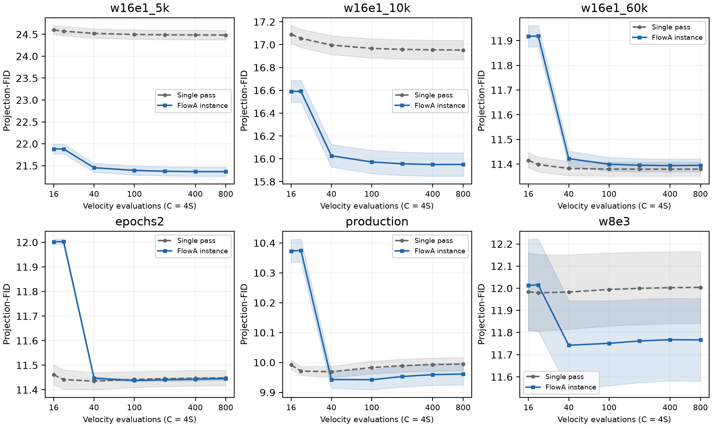
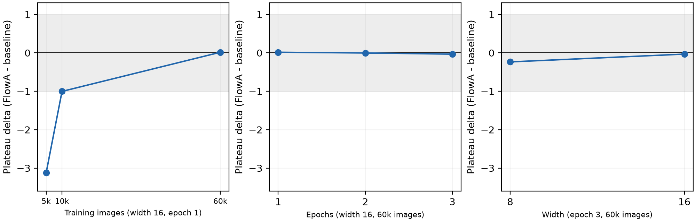
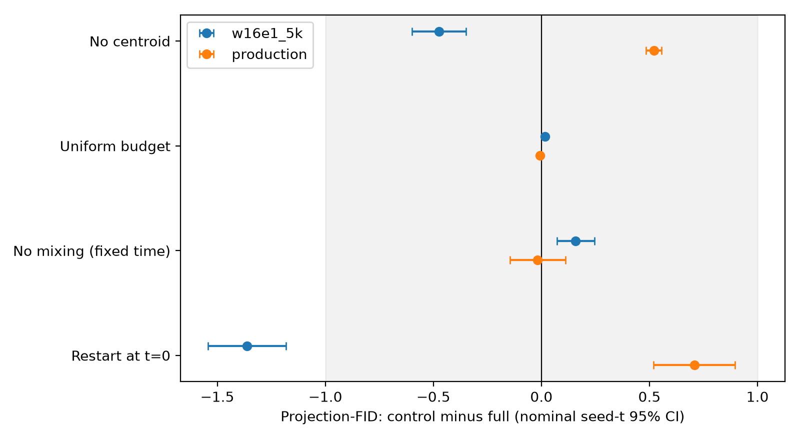
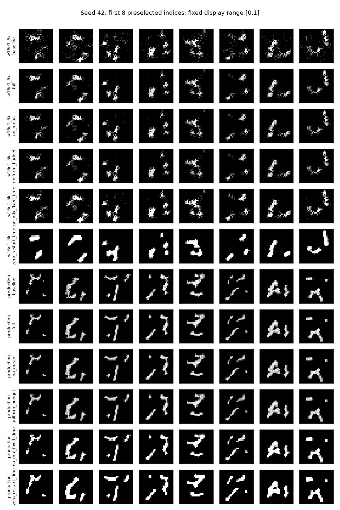
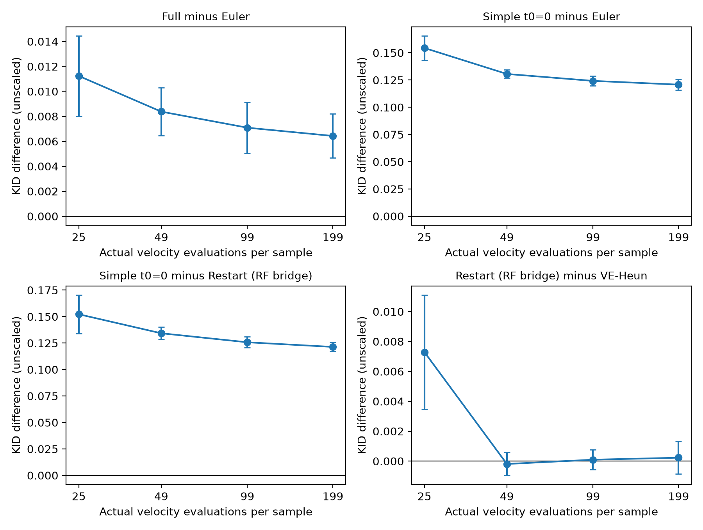
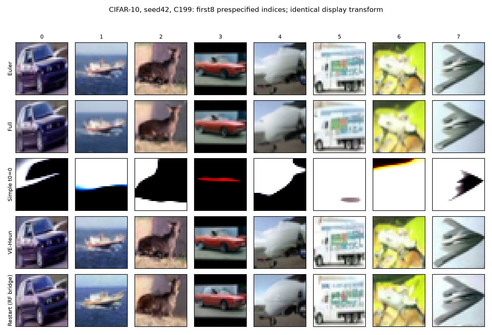
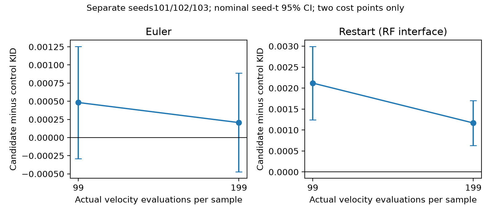
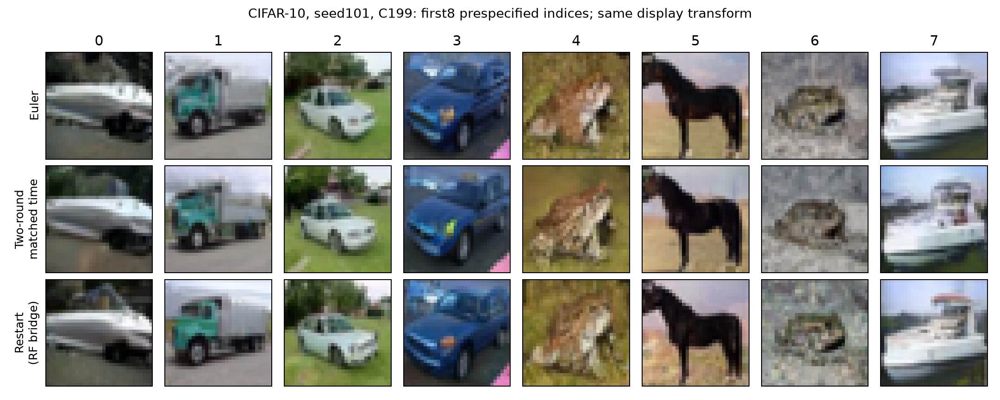
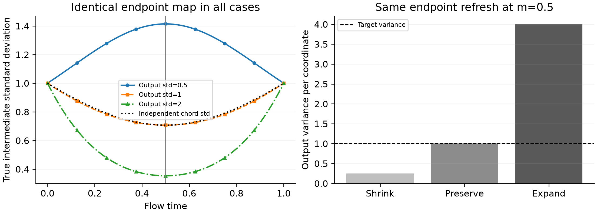
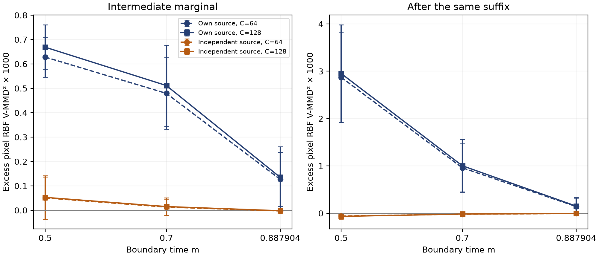

# 流匹配端点再推理的目标保持条件与经验边界

中文修订稿 v9｜机制与边界分析论文｜2026-11-03

本文研究冻结检查点下的端点再推理。中文稿采用完整研究论文的组织方式；英文期刊模板、匿名材料和正式篇幅另行编排。

## 摘要

冻结流匹配模型可以通过混合生成终点与新先验、随后再次积分来改变输出分布，但这种边界操作何时保持目标、何时引入偏差，取决于训练耦合与实际推理路径。本文以明确的端点再推理实例为对象，区分目标保持、状态收缩与有限成本质量改善。首先，对独立端点插值给出理想目标保持条件；对确定性凸梯度输运路径，将刷新引起的矩缺口表示为经典输运成本差和Bregman期望，并由此导出条件W₂下界及近似路径的误差限制。其次，通过六个MNIST检查点、匹配主参数的组件干预和独立CIFAR-10检查点对照，检验边界操作的实际收益。MNIST仅一个弱检查点满足所采用的projection-FID前沿规则，平台改善12.75%，其余五个持平；组件作用随检查点反向。CIFAR五臂匹配调用研究中，完整配置减Euler的未缩放KID对数成本面积差为+0.008078，未支持迁移优势；另行锁定的两轮候选也未达到预设改善条件。进一步构造端点映射完全相同的光滑流，证明固定的端点刷新仍可产生任意正的高斯输出尺度；36个CPU控制验证了端点诊断与真实中间边缘的区别。12个既有CIFAR操作点未发现有限配对违例；新增真实检查点的三种子、双分辨率边界干预进一步发现，逐样本更接近轨迹的原噪声弦线反而比独立噪声弦线更偏离中间边缘及接续终点。该发现限于指定像素指标与数值协议，独立臂接近参照不等于目标保持已被证明。结果表明，正确时间对应只是理想分析中的一项条件，轮次边界操作还需结合耦合、数值实现和评价对象检验；状态收缩及端点配对成本不能单独承担质量保证。

关键词：流匹配；端点再推理；训练耦合；目标保持；生成模型评价。

## I. 引言

流匹配通过学习速度场将简单先验输运至数据分布，整流流则进一步关注输运路径的形状与生成成本[1],[2]。在模型参数冻结后，推理仍保留积分器、时间网格、初值和状态后处理等选择。其中，轮次边界的状态重构提供了一种直接干预：将上一轮生成终点与新的先验样本组合，再从指定时刻积分至终点。与加密同一数值轨迹相比，这一操作改变了输入后段流的状态分布，因此既可能改变有限成本的质量平台，也可能引入新的分布偏差。

已有重启采样和再噪声方法为这种干预提供了基础[3],[4],[5]。然而，一项状态操作能够被实现，并不自动意味着它与训练路径相容。即使刷新后的源边缘与先验相同，源端和终点的联合关系也可能已经变化。若重组状态不再服从对应的中间边缘，精确的后段流同样可能输出错误分布。因此，讨论端点再推理需要同时回答两个问题：该边界核是否保持所研究的目标，以及学习与有限步积分条件下的质量读数是否改善。

这两个问题存在实质区别。理想目标保持是概率路径与映射之间的关系；同步噪声下的状态收缩是不同输入间的稳定性性质；生成质量则由指定数据、检查点、指标和有限成本协议共同定义。错误目标也可能是收缩核的平稳分布，而某一指标下降也未必伴随另一指标或感知质量改善。本文以这一区分为主线，避免用单一收缩系数解释不同检查点和评价器上的全部现象。

本文研究的FlowA实例将终点记忆、新先验、重启时间、轮次预算和输出质心处理分别定义。研究不依赖重新训练检查点：MNIST实验覆盖数据规模、训练延长与宽度三个可解释的检查点轴；组件实验在相同主参数下作单因素干预；CIFAR研究固定另一模型的权重、先验政策、评价器和实际速度场调用次数，并加入原Restart函数适配及无重启求解器控制。另行锁定的候选协议仅留出生成随机性，用于检验一次明确的配置修正，结果与主研究分开报告。

本研究形成三方面相互衔接的分析。第一，将端点再推理写为可复核的随机边界核，说明独立插值路径上的充分条件，以及训练耦合、时间约定和批次处理改变这些条件的方式。第二，在确定性凸梯度路径上分析刷新造成的分布偏差，给出矩缺口、W₂下界、取等例子及近似梯度路径的失效边界。该分析建立在经典输运最优性与凸性工具之上，不将重启操作或成本差恒等式列为独有发现。第三，以匹配调用、匹配组件和独立检查点研究界定实际适用范围，并用既有端点缓存检查一项理论必要条件；端点不可区分的光滑流反例进一步说明，端点配对信息不能替代中间边缘观测。新增真实中间轨迹干预将逐样本路径接近与边缘相容分开检验。本文的实证结论包括局部收益、作用反向和迁移退化，覆盖范围由各实验设计分别限定。

全文首先介绍相邻方法和评价对象，随后定义实际边界操作并给出条件分析。实验部分依次呈现检查点前沿、组件干预、独立CIFAR对照与有限端点诊断，讨论这些观察对目标保持与实际收益之间关系的启示。历史跨域记录用于说明适配和评价范围，放入附录，不承担主机制的独立正向确认。

## II. 相关工作与评价对象

### A. 单轨迹求解、训练改变与重启

流匹配和整流流提供了学习连续输运的训练框架[1],[2]。在推理阶段，数值求解器改变对既定动力学的近似方式。以扩散模型的 DPM-Solver 为例，其重点是利用模型方程结构减少求解成本[6]；这与重新构造一个轮次的初值是不同的干预。本文没有在所有模型上复现这些专用求解器，因此这里只比较干预对象，不将设计层面的差异写成数值优越性。

训练阶段的路径改变与蒸馏则作用于检查点本身。整流流的 reflow 重新学习输运，一致性模型学习跨轨迹时刻的映射，以支持少步生成[2],[7]。本文固定速度场，不通过新的训练获得再推理收益。保持权重不变是一项协议约束，不能据此推出对训练或蒸馏方案的总体效率优势，因为总训练成本与部署需求并未在同一实验中比较。

生成过程中的随机性和重启具有更直接的相关性。基于随机微分方程的生成建模统一了不同噪声演化与校正方式[8]；Restart 在额外前向扰动与后续 ODE 采样之间交替[3]。FlowA 的 MNIST 实例采用前一轮终点和新先验的混合，并令混合比例关联重启时间。它还包含特定预算安排和样本质心处理。已有实验隔离了质心平移这一组件，但其累计噪声参数为 0.5，区别于主前沿的 0.3；新增主参数的单因素组件矩阵见第 VI-D 节；它覆盖两个检查点和一个成本点，尚非全因子实验或所有六检查点前沿。主前沿仍对应完整实例，不能断言某一环节是优势的唯一来源。

| 比较对象 | 主要改变 | 是否改变检查点权重 | 本文能够作出的比较 |
|---|---|---|---|
| 单次流匹配 / 整流流积分 | 从一次先验完成输运 | 推理时不变 | 同检查点的直接基线 |
| 数值求解器 | 单轨迹的离散化与求值安排 | 通常不变 | 操作层次比较，不声称全面优于专用求解器 |
| Reflow / 一致性学习 | 学习路径或映射 | 需要训练相应模型 | 固定权重约束的区别 |
| Restart sampling | 扰动后继续生成演化 | 可用于冻结模型 | 同 RF 检查点原函数适配与 VE-Heun 控制；不把重启列为首次贡献 |
| 本文 MNIST 实例 | 轮次状态、部分区间、预算与质心 | 不变 | 测量完整配置的检查点条件性结果 |

表 I. 比较对象与本文能够支持的比较层次。

### B. 最接近干预的具体差异

Restart 原文算法在预定噪声区间注入前向扰动，再沿反向 ODE 积分；其扩散模型伪代码按噪声日程设置扰动核，默认示例使用 Heun，但并不限定求解器[3]。本文 MNIST 实例则混合前轮终点与新先验，将混合权重对应到部分流时间，固定总 RK4 调用预算，并加入批次质心保持。操作上的差异不能替代同检查点、同模型调用次数与同评价器的结果比较；本研究通过同 RF 检查点上的原函数适配补充匹配调用对照，另设 VE-Heun 控制求解器和时间网格变化；这不等于复现原 EDM/VP 检查点的最佳发表结果。

LineageFlow 原文还提出中间时刻的 rerouting，以变异、选择和扩增后继续流积分[9]。它同样属于冻结参数下的状态干预，须纳入直接相关工作。本文主实例没有运行该选择目标，也没有把框架接口上的反馈能力等同于其选择操作；现有蛋白随机序列基线不能承担与该 rerouting 的公平比较。Kanzi 的流匹配自编码器[10]和 FlowMol3 的连续坐标/离散类别联合生成器[11]则分别规定了表示与状态空间，不能仅因接入了它们就新增一项方法优势。

2026 年的 Diamond Maps 进一步给出再噪声后继续流映射的构造[4]，其端点特例与本文的混合操作相合；NR-SMC 则在奖励重采样时用端点估计和新源噪声重建中间状态[5]。本文没有它们的完整后验、价值函数或奖励粒子目标，不把状态操作视为独有创新，也不将本次无条件图像对照解释为胜过这些完整系统。流匹配路径与随机动态的基础关系参见[12],[13]。训练耦合偏离与指导稳定性的联系已由 Coupled Guidance 分析[14]；ReCouple 则研究训练配对、网络实现及有限成本采样之间的影响[15]。前者的指导任务与后者的后训练目标不同于本研究，但都说明耦合重要性本身不能视为独有发现。

小批配对优化在Multisample Flow Matching中已用于构造训练路径[16]，其作用阶段区别于冻结模型的边界重构。关于reflow与小批最优输运的极限分析进一步区分有限阶循环单调性与全局最优性，并给出旋转反例[17]。因此，有限样本上没有找到更低成本的重排，只能视为一项必要条件检查。

在有观测约束的恢复任务中，ReBridge-Flow通过协调源端与干净端点改善桥兼容性[18]；MMD Guidance则利用参考分布的核差异调整生成动态[19]。这些工作说明耦合兼容和边缘匹配已有明确方法基础。本文关注指定无条件边界核的保持条件及其受控评价，不将双端点修正或核距离引导概念作为贡献。后文的Bregman表示与输运最优性关系参照经典OT框架解释[20]。

近期CMM以累计边缘差异构造少步模型训练目标[21]；CorrFlow训练利用冻结基模型表征的残差修正器，并分析修正后的部署状态分布[22]。前者已明确研究中间边缘，后者已把轨迹变化纳入修正分析，因此“关注中间状态”并非本文独有。本文不训练新模型，新增的是同一冻结检查点下将真实轨迹、原噪声弦线与独立噪声弦线置于相同后段网格的边界干预。它用于检验假设对应，不宣称在共同基准上优于这两套系统；两项2026预印本的结论亦不写为同行评议定论。

### C. 质量—计算量前沿

我们把完整方法实例记作 A，将其在检查点 θ、预算 C、种子策略 s 下的质量记为 Q(A,θ,C,s)。比较时固定 θ、样本规模、特征评价器和先验策略。对较低为好的指标，定义 Δ(C)=Q(FlowA,θ,C,s)−Q(base,θ,C,s)。单个负差值只是一个操作点的方向改善，不能单独证明整条前沿占优。

前沿比较使用共同网格，同时检查逐档差值、不确定性和高预算平台。平台定义必须先于结果选择。我们沿用原登记的绝对效应阈值，并保留已有 WIN/TIE 判定；这些标签服务于该实验的决策规则，不是统计等效或所有预算档均无损的同义词。跨模型指标不共享同一个阈值，也不共享一个数值尺度。

### D. 指标与成本的可比性

标准图像 FID 使用特征分布的均值与协方差[23]。本项目 MNIST 实验使用像素的固定高斯随机投影特征，默认从 784 维投影至 128 维，再计算 Fréchet 距离。本文始终称其为 projection-FID；它不是 Inception 特征 FID，也不与其他论文的标准 FID 数字直接比较。CIFAR-10 的 Inception 评价另列。

计算量用两个变量区分：S 表示积分步数，C 表示每样本速度场评估次数。本文已核对的 MNIST NumPy 与 Torch 后端均为四阶段 RK4，故 C=4S。历史文件的 nfe 字段在这些路径上实际表示 S。本文图表以真实函数评估 C 为横轴，并在复现索引保留历史 S 标签。这种统一换算不改变同求解器两臂的预算匹配、平台数值或比率；它也不把质量改善转化为实测墙钟加速。

### E. 数据与评价来源

主数据为 MNIST[24]，独立图像验证使用 CIFAR-10[25]。MNIST 检查点来自项目训练流程；CIFAR 冻结检查点的来源和 EMA 提取核查见第 V-E 节。数据集、检查点、特征评价器与评价参考是不同对象。投影 Fréchet 与 TF-port Inception 指标分别解释，历史 torchvision 缓存也不与新研究混用。其他任务的代理指标及其来源单独列入附录 A。

## III. 方法与主实验实例

### A. 一般轮次控制

设 vθ 为冻结速度场，Φθ(a→b;Sk) 为在时间区间 [a,b] 上以 Sk 步近似得到的流映射。第 k 轮终点记为 ek，新先验记为 ξk，轮次混合操作为 Bk。一般更新写成：

xk = Bk(ek−1,ξk)，  ek = Φθ(ak→1;Sk)[xk]。                 (1)

首轮从先验开始，a₁=0，不需要先前终点。后续时间起点 ak、混合操作和预算均属于方法定义。式（1）容纳固定与反馈更新策略，但不要求所有实验都使用同一调度器。对于离散类别和图通道，Bk 必须由适配器规定合法操作，不能把线性欧氏插值直接当作已验证方案。

### B. MNIST 的混合与时间对应

MNIST 主实例在连续像素状态上使用终点记忆与新先验的凸混合。设总新噪声参数为 βtot=0.3，总轮数为 R。对于 R>1，每次实际重启使用：

βr = 1−(1−βtot)^(1/(R−1))，  m=1−βr。                 (2)

于是 R−1 次混合中形式上的记忆保留系数乘积为 1−βtot。这个代数关系不代表中间积分后的实际信号或方差也按同一比例保留。四轮时 βr≈0.112096，不能把 0.3 或历史汇总字段中残留的 0.5 直接解释为每轮实际新噪声权重。

新先验来自适配器的高斯采样及像素范围截断。后续轮次以 xk=m ek−1+βr ξk 开始，并在 memory 模式下令 ak=m，只积分 [m,1]。四轮时后续区间起点约为 0.887904。这里的时间对应来自所采用的线性流路径参数化；对于不同状态空间或噪声日程，需要重新确定相应关系，不能默认沿用。

### C. 总预算与低预算轮数

实验的历史预算网格 S∈{4,5,10,25,50,100,200} 对应真实速度场评估 C∈{16,20,40,100,200,400,800}。每个框架臂满足 ΣSk=S，基线也用 S 步 RK4。当前低预算协议采用平均预算参数 h=2，将实际轮数限制为 R=min(4,max(1,⌊S/h⌋))；因此 S=4 和 5 使用两轮，而较高预算通常使用四轮。轮数变化还会改变式（2）的每次混合比例。

参数 h 的历史命名为 min_steps_per_round，但它只限制平均轮次预算，不逐轮强制 Sk≥h。实际分配仍只保证 Sk≥1；例如 production、S=50、R=4 的 evidence_driven 臂分配为 [25,18,6,1]。因此本协议并不逐轮保证至少两步。各轮步数由选定调度器提前提供的权重分配，并使总和精确等于 S。该 MNIST 驱动没有调用运行中的 record_round_feedback；EvidenceDriven 名称不能据此被解释为实验已闭合在线反馈环。通用 runner 具备反馈调用路径，这是实现能力，与当前主结果实际使用的策略分别报告。

### D. 样本质心保持

主实例还启用了 mean_preserve。生成时保留首轮终点集合 E₁，完成所有轮次后得到 ER，然后作批次平移：

xout,i = eR,i − mean(ER) + mean(E₁)。                 (3)

该操作不使用参考测试集，且不额外调用速度场；它使用当前生成批次的均值，因此是总体样本级操作，不是逐样本独立映射。E₁ 对应框架首轮分配到的预算，并非必然等于使用全部预算的单次积分基线。平移改变特征均值而不改变协方差，可能直接影响 Fréchet 类指标。主结果应归于包含该步骤的完整配置，不能全部归于重启或调度。

### E. 可执行流程

| 算法 1：MNIST 主实例 | 操作 |
|---|---|
| 输入 | 冻结检查点；生成种子；样本数 N；总积分步数 S；βtot=0.3；最大轮数 4；平均预算参数 h=2；实际 Sk≥1 |
| 配置 | 确定实际 R、每轮 βr、时间起点及调度权重；分配正整数 Sk，总和为 S |
| 首轮 | 使用与基线共享的先验政策，RK4 积分 [0,1]；保留终点样本及其均值 |
| 后续轮次 | 生成记录键控的新先验；与上一轮终点混合；从 1−βr 积分至 1 |
| 输出处理 | 按式（3）将最终样本均值锚定于首轮终点均值 |
| 计量 | 记录积分步数及换算后的 C=4S；评价开销、后处理和墙钟时间另计 |

共享先验保证比较对象的初始随机政策可对应，但后续重启使用额外随机输入。各臂的随机输入生成方式必须随协议报告。本文没有假定固定种子天然保证任意两条模型路径构成统计意义上的天然配对，也没有将批次质心处理后的 N 个输出视为 N 次独立运行。

### F. 独立模型实例与接口边界

CIFAR-10 使用冻结 1RF 速度场，在同权重、同先验政策下分别实现 Euler、完整轮次配置、简化候选和原 Restart 去噪器接口适配。状态与时间转换及实际调用规则见第 V-E 节。接口能够表达一个操作，不代表它保持任意训练路径的边际分布；连续线性插值也不能直接移植为离散类别或图通道的合法更新。其他任务的实际启用路径与比较对象另列附录 A。

## IV. 随机边界核、目标保持与失效条件

### A. 独立端点路径下的目标保持

设目标分布为 μ、先验为 ν，均有有限二阶矩。明确假设训练路径来自相互独立的 Y∼μ、Z∼ν，即 μt=Law(tY+(1−t)Z)。设理想后段流映射 Φm 满足 (Φm)#μm=μ。对独立新先验 Z′，定义 Km(x)=Φm(mx+(1−m)Z′)。若输入 X∼μ，则混合状态正好服从 μm，故 Km 的输出仍服从 μ。这是路径分布和推送关系的直接推论，给出了状态系数与重启时间对应的充分条件。

这一操作并非本文独有：Diamond Maps 的一般再噪声与后续映射公式可特化到该端点情形[4]。无条件目标保持也不等于条件后验正确性。理想核的结论不能直接移植到误差未知的学习映射、数值积分、状态裁剪或输出批次处理。

### B. 实际积分映射的误差递推

将第 j 次后段积分记为 Fj，假设它在状态空间上为 Lj-Lipschitz。令 εj=W₂((Fj)#μmj,μ)，aj=mjLj。把输入分布 q 与 μ 的耦合使用同一个新先验，即可先得到混合后距离至多 mjW₂(q,μ)，继而由映射的 Lipschitz 性和三角不等式得到：

Dj ≤ aj Dj−1+εj。                                               (4)

不同轮次预算改变 Fj，故一般应使用 Dk≤(Πj aj)D0+Σj[εj Πl>j al]。若 aj≤a<1 且 εj≤ε，则 Dk≤a^kD0+ε(1−a^k)/(1−a)。初始距离大于 ε/(1−a) 时，该上界允许一次改善；距离较小时不提供改善保证。Lj 与 εj 未经认证时，这只是有条件的分析，不能直接用于选择部署参数。收缩与新增误差的竞争已有 Restart 等研究[3]；式（4）是针对本研究核写出的标准耦合推论。

主实验的预算分配可能含一步轮次；它影响的是实际 Fj 的误差和稳定性，不能从“轮数增加”直接推出改善。CIFAR Euler 的物理时间采用 τ=.001+.999u，而完整配置按 u=m 混合；它与理想 τ=m 存在小偏差，且官方 Euler 增量按 du 计算。这些数值约定保留在协议中，不为套用理想性质而修改。

### C. 精确高斯例子与训练耦合反例

独立路径的先验 N(0,1)、目标 N(0,s²)具有中间方差 qm=m²s²+(1−m)²。理想后段映射为 Fm(x)=sx/√qm，因此边界核的线性系数 a=ms/√qm、b=(1−m)s/√qm 满足 a<1、a²s²+b²=s²，目标方差保持。若将相同混合状态交给从零开始的映射 F0(x)=sx，则这一恒等式一般失效；例如 m=.8、s²=4 时，目标样本的方差一次后由 4 变为 10.4。某个弱检查点上零时间重启的指标更低，不能使它成为一般正确的时间对应。

独立训练耦合这一条件也不能省略。取先验与目标同为 N(0,I)，训练配对为 Y=Z，则精确速度场恒为零，单次积分已精确。端点混合却产生 Xnext=mX+(1−m)Z′；其一次方差为 [m²+(1−m)²]I，平稳方差为 [(1−m)/(1+m)]I。m=.8 时，方差先变为 .68，最终趋向 1/9，尽管同步噪声下的状态收缩因子为 .8。批次均值保持也不能恢复缩小的协方差。这是合法耦合下的解析反例，不是声称实际 MNIST 或 1RF 检查点采用了该耦合。

进一步令高斯训练配对满足 Var(Y)=s²、Var(Z)=1、Cov(Y,Z)=ρs，中间方差为 qρ=m²s²+(1−m)²+2m(1−m)ρs。在该路径的精确后段映射下，独立刷新得到的目标方差比为 [m²s²+(1−m)²]/qρ。因此正相关配对导致收缩、负相关配对导致膨胀；独立性偏离并不只是数值精度问题。若真正知道训练条件分布，可取 Z′=(ρ/s)X+√(1−ρ²)ξ 重建正确配对边际，此时目标方差保持。但一般速度场不提供这个条件采样器；ρ=1 时该修正退化为确定性恒等更新，不再产生新随机探索。这里给出的是高斯解析诊断，不是任意学习路径上的可部署修复或独有方法贡献。

### D. 确定性凸梯度路径上的刷新偏差

前述高斯反例可推广到一类明确的非线性输运路径。设ν具有有限二阶矩，u∈C²(Rᵈ)，∇²u≽αI、α>0，T=∇u，μ=T#ν亦具有有限二阶矩，且u关于ν可积。定义Aₜ=(1−t)I+tT、Fₜ=T∘Aₜ⁻¹，其中0<t<1。强凸性保证T与Aₜ全局可逆；对应的精确路径满足vₜ(Aₜz)=T(z)−z。这里指定全空间映射；若ν离散，并不据有限支持上的训练损失声称已经识别该全空间速度场。

令Z和Z′具有相同边缘ν，允许二者相关，也允许刷新核非可逆。保持终点X=T(Z)不变，记W=Aₜ(Z)、W′=tT(Z)+(1−t)Z′、Y=Fₜ(W′)。令E_Q=E||Z′−Z||²，Dᵤ(a,b)=u(a)−u(b)−∇u(b)·(a−b)。

**引理1（刷新矩缺口）。** W与W′均值相同，其中心二阶矩差满足

Δₜ = E||W−EW||² − E||W′−EW||² = 2t(1−t) E Dᵤ(Z′,Z) ≥ αt(1−t)E_Q。    (5)

证明：展开两平方，利用两源边缘相同消去纯源项，再利用E[u(Z′)−u(Z)]=0得到Bregman期望；强凸性给出最后的不等式。若E_Q>0，则中间边缘不同。由于Fₜ可逆，Law(Y)亦不同于μ。该结论不依赖模型误差或积分误差。

引理1也可写为Δₜ=t(1−t){E||T(Z)−Z′||²−E||T(Z)−Z||²}。故其非负性直接联系经典二次输运最优性[20]，成本差恒等式本身不承担新颖性主张。它在此处的作用是明确一个适用边界：保留相同先验边缘，仍不足以保持确定性输运耦合。允许移动终点、改变路径或采用不同随机动态的采样器不受此固定终点结论排除。

### E. 输出分布偏差下界与可取等例子

**命题1（条件W₂下界）。** 记Mₜ=E||W−EW||²及Lₜ=t+(1−t)/α。在引理1条件下，

W₂(Law(Y),μ) ≥ {√Mₜ−√(Mₜ−Δₜ)}/Lₜ。                         (6)

证明：逆后段映射Gₜ=Fₜ⁻¹=tI+(1−t)T⁻¹的Lipschitz常数至多Lₜ。对任意耦合，Minkowski不等式给出W₂至少为两个同均值分布的中心L²半径差；再对Gₜ使用Lipschitz推前不等式即得式（6）。Fₜ的导数特征值形如λ/[(1−t)+tλ]≤1/t，因此所涉及的输出仍具有有限二阶矩。Mₜ−Δₜ是W′的真实中心二阶矩，不是假定为正的自由参数。

取ν=N(0,I_d)、T=sI、s>0，Z′=ρZ+√(1−ρ²)ξ，ξ独立同先验，−1≤ρ≤1。此时中间分布为各向同性高斯，Gₜ为标量缩放，式（6）两步不等式均可取等。ρ<1产生严格偏差，ρ=1退化为恒等刷新。故该下界在这一族上具有锐性；这不表示它能在一般神经模型上直接计算。

线性SPD情形还允许检查输出二阶矩。若T(z)=Bz+b，B对称正定，A=(1−t)I+tB、H=B³A⁻²、δ=Z′−Z，则

tr Cov(T(Z)) − tr Cov(Y) = t(1−t) E[δᵀHδ]。                  (7)

同边缘给出对任意对称矩阵M的关系2E[ZᵀMδ]=−E[δᵀMδ]；将Y=BZ+b+(1−t)BA⁻¹δ展开并合并即得式（7）。迹减小不等于协方差矩阵在Loewner序下减小；各方向可能有不同变化，具体反例与数值检查见第VI-I节。若T不满足凸梯度假设，偏差符号也不受引理1限制。

### F. 近似路径的限制

令真实确定性直线路径的端点映射为S(Z)=T(Z)+e(Z)，ε²=E||e(Z)||²。定义W_S=(1−t)Z+tS(Z)、W′_S=(1−t)Z′+tS(Z)。对同一刷新能量E_Q，平方展开和Cauchy–Schwarz给出

Δ_S ≥ t(1−t){αE_Q−2ε√E_Q}。                                (8)

因此E_Q>4ε²/α²是保证正中间矩缺口的一项充分条件。阈值以下不能据此判定无偏。只有S、Aₜ^S可逆且真实逆后段映射的Lipschitz上界已知时，才可进一步转成相应的输出W₂下界。

这一限制不可简单改为“路径接近OT”。在二维标准高斯先验上，令T=I、S=I+ηJ，J为90度旋转，Z′=R_θZ。S始终1-强单调，但其非梯度部分使Δ_S=4t(1−t)[1−cosθ−ηsinθ]。任意η>0均可在足够小的正θ下使该量为负。故小的非梯度误差也可能翻转矩变化方向；强单调性单独不足以替代凸梯度假设。

式（5）—（8）说明的是所列路径上的分布偏差。实际检查点上的α、ε与逆映射上界尚未认证，这些式子不能直接充当部署参数选择规则或FID/KID质量保证。有限端点配对检查只能尝试排除一项必要条件，第V-G与VI-J节分别给出其协议和结果。

### G. 端点诊断的可识别性与中间边缘

端点配对检查只约束一项映射。即使知道完整的端点映射，而不只是有限样本，通常仍不能恢复路径的全部中间边缘。随机插值框架本就允许在给定两端分布后设计不同路径[13]；下面将这一已知自由度具体用于端点刷新问题，给出可直接核验的不可区分构造。

**命题2（端点信息的不足）。** 固定0<m<1，先验与目标均为二维标准高斯。存在一族全局光滑、可逆的确定性流，所有成员均具有Φ₀=Φ₁=I及相同的端点联合分布Law(Z,Z)，但对同一独立刷新W′=mX+(1−m)Z′、X=Φ₁(Z)，其精确后段输出可以为N(0,σ²I₂)，其中σ为任意给定正数。

证明：令c=m²+(1−m)²，qₛ=exp(a sin(πs))、θₛ=b sin(πs)，Φₛ(z)=qₛR(θₛ)z；R为二维旋转，b为任意固定实数。q₀=q₁=1，θ₀=θ₁=0，因此端点映射恒为I。这是速度场vₛ(x)=πcos(πs)(aI+bJ)x的精确流，J为90度旋转矩阵，所有时刻qₛ>0。取a=log(√c/σ)/sin(πm)，则真实中间边缘为N(0,qₘ²I₂)，而重组状态为N(0,cI₂)。精确后段映射为Φ₁∘Φₘ⁻¹=qₘ⁻¹R(−θₘ)，故

Cov(Y) = (c/qₘ²)I₂ = σ²I₂。                              (9)

当σ<1、σ=1及σ>1时分别收缩、保持及膨胀。所有成员的端点样本和全局端点配对成本完全相同，因此任何只读取这些端点信息的规则都无法在该流族上判定刷新是否保持目标。此结论不假设这些成员来自相同的独立直线训练路径；已知训练概率路径时，可以排除不相容的成员。它也不把一般路径非唯一性作为首次发现。

中间边缘则包含这一构造中缺少的信息。设rₘ为重组分布，μₘ为真实中间分布，F为把μₘ推至μ的精确可逆后段映射。若F与F⁻¹的Lipschitz上界分别为L和L⁻，且相关分布具有有限二阶矩，记dₘ=W₂(rₘ,μₘ)，则标准推前不等式给出

dₘ/L⁻ ≤ W₂(F#rₘ,μ) ≤ Ldₘ。                              (10)

上界直接对F使用Lipschitz推前性质；下界对F⁻¹使用同一性质。可逆性还给出F#rₘ=μ当且仅当rₘ=μₘ。在命题2的高斯流族中，两侧均精确等于dₘ/qₘ，因此既有保持例子，也有尺度可计算的失配例子。式（10）是经典距离传播的推论，不承担独有理论工具主张。实际神经流的逆映射界尚未认证，不能将该式升级为FID/KID证书。

命题2说明端点信息不足以识别一般边界核的正确性；式（10）解释了测量真实中间边缘的必要作用。二者为第VI-J节有限缓存检查提供适用边界，也为后续诊断提出要求：区分真实轨迹边缘与端点直线插值边缘，再检验预定干预的作用，而不是从未发现端点违例直接推断实际刷新无偏。

### H. 与经验诊断和评价指标的区别

经验 κ=tr(Σframework)/tr(Σbaseline) 是已生成特征的离散度比，不是式（4）的 mjLj，也不提供全局 Lj 上界。历史四检查点 κ 约为 .6666、.7384、.8931、.9585；它们在历史 S=50 下测量，平台则汇总 S=100/200，且 κ 汇总多个比较臂，因此只作家族内描述。κ<1 既可能反映修正，也可能反映分布收缩过度。

最终批次平移 δ 对固定经验分布的 W₂ 位移等于 ||δ||，但相对目标的变化符号不定。它还会使同批输出相关。projection-FID、Inception FID 与核距离各有自己的估计对象，均不能直接被当作图像分布的真实 W₂；定性样本和独立协议用于检验这些差异的实际影响。

## V. 数据、协议与统计

### A. 六检查点的受控轴

| 检查点 | 基础宽度 | 训练图像数 | Epoch | 优化步数 | 用于分析的轴 |
|---|---:|---:|---:|---:|---|
| w16e1_5k | 16 | 5000 | 1 | 78 | 固定宽度与 epoch 的数据规模轴 |
| w16e1_10k | 16 | 10000 | 1 | 156 | 同上 |
| w16e1_60k | 16 | 60000 | 1 | 937 | 数据规模轴与 epoch 轴交点 |
| epochs2 | 16 | 60000 | 2 | 1874 | 固定宽度与数据的 epoch 轴 |
| production | 16 | 60000 | 3 | 2811 | 同上；也是宽度对照 |
| w8e3 | 8 | 60000 | 3 | 2811 | 同数据、epoch 和优化步数的宽度对照 |

表 II. 六检查点的训练配置与分析轴。

数据规模轴同时改变可见训练样本和一轮训练所需优化步数，故不是纯粹隔离优化步数的实验。epoch 轴固定架构和数据，能够比较训练延长后的检查点，但没有多个独立训练种子来支持广泛因果推断。本文按这两条轴分别分析，而不将全部五个优化步数水平包装成一个无混杂的单因素实验。

### B. 采样、前沿与阈值

每臂每种子 N=1000，生成种子固定为 42、43、44，主比较臂为 evidence_driven 对应的预定预算实例。四个原检查点来自 NumPy 路径；新增检查点的完整网格主要来自 Torch float64 路径，最低两档的轮数限制修正来自 CPU 重算。后端一致性有既有数值核对记录，但跨后端相符不等于环境任意变化都逐字节一致。

主表使用最低两档已应用h=2 轮数限制的当前前沿；不能用未限制的低预算 LOSS 与限制后的其他检查点构成一个混合比较。平台取历史步数 S=100 与 200 的均值，真实速度场调用为 C=400 与 800。前沿判定沿用绝对效应阈值 1 个 projection-FID 单位，并将相对 1% 规则的不同结果作为敏感性而非择优结论。

### C. 统计单位与解释

主曲线的汇总单位是三个生成种子，而非每个种子中的一千张图像。配对自举区间只有三个种子提供的差值信息；重采样一万次不会产生新的独立重复。本文将其作为当前三种子条件下的区间描述，区分区间是否排除零与是否超过实际效应阈值。

不同预算档共享检查点和种子，不能把七档曲线视为七个独立验证任务。四检查点回归只有四个观察点，含截距和斜率后残差自由度为 2，双侧 95% 区间应使用 t0.975,2≈4.302653[26]。本研究使用这一自由度报告区间；较高拟合度不替代独立家族的预测验证。

跨域统计遵循各单元原有设计。记录匹配、合成结构变体、家族聚类和独立种子的单位应分别列出；Kanzi 的记录复算区分旧索引差值与 Welch 敏感性；其合成变体不被视为独立天然结构。其他缺少逐记录文件的单元仍不标为已独立复算。工程完整性检查仅验证文件和引用关系，不能替代这一统计核查。

### D. 匹配组件协议

组件实验在首个试运行前将协议锁定于项目本地文件，时间为 2026-11-02 17:15:15 UTC；这不是公共注册。检查点固定为 w16e1_5k 与 production，种子固定为 42/43/44，不补种子。每臂每种子 N=1000，S=50、RK4 实测 C=200、R=4、βtot=.3，主特征与历史记录相同。所有框架变体沿用同一 arm 名及键控随机政策，避免仅因臂名改变先验。

六臂分别为单轮基线、完整配置、只关闭最终质心平移、只改均匀步数分配、关闭新先验混合但保持后续起点 0.887904、只将后续积分起点改为零。原分配为 [25,18,6,1]，均匀分配为 [13,13,12,12]；后者同时改变作为质心锚的首轮终点，这是该干预的中介变化。关闭混合时保留部分时间区间，避免混合强度与重启时间同时改变。六次完整配置及基线均通过与历史同种子结果误差小于 10⁻⁴ 的复现保护。

主检验族预先限定为四种组件干预 × 两个检查点的八个配对种子差值，方向为“变体减完整配置”，双侧 t 检验自由度为 2，采用 Holm 校正。95% t 区间为逐比较名义区间，不是同时区间；三个运行种子并不构成训练种子重复。1 个 projection-FID 单位为预定实用效应参照，不能以显著性代替实用性，也不能以一个预算点认定整条前沿获胜。

探索性第二指标沿用三次多项式核的无偏 MMD U 统计量思想[27]，在相同 128 维投影特征上计算，参考子集固定为种子 20261103 抽取的 1000 张图像。文中称 projection-KID；它不是 Inception KID，不与标准 KID 量级比较。由于质心处理导致批次内相关性，不将该统计量在独立样本下的总体无偏性外推到所有臂。该指标未加入主检验族，仅用于揭示结论对评价函数的依赖。所有臂预先保存前 64 个索引用于作图，不按结果挑选样本。

### E. 独立 CIFAR-10 五臂匹配协议

独立检查点为官方 1-Rectified Flow 的 CIFAR-10 DDPM++ EMA 权重[2]。564 个推理参数与保存的原始 EMA 逐个相同；项目网络与原 NCSNpp 已通过逐点前向核对，完整 Euler 采样函数也在同初值下核对一致。评价统一使用 pytorch-fid 的 TF-port Inception 2048 维特征和同一 10000 张测试图像参考；不混用旧 torchvision 特征缓存，也不与文献 50000 张生成图像、不同参考集和求解器的 FID 数值直接比较。

协议在试运行和正式比较前本地锁定，不是公共注册。每臂每次 N=1000，种子固定为 42/43/44，真实每样本速度场调用 C∈{25,49,99,199}。所有臂共享同种子的高斯初始矩阵。三种 Euler 配置分别为单次积分、迁移主参数的四轮完整配置，以及均匀预算、关闭质心且后续从零开始的简化候选。后者由 MNIST 局部消融启发，是需要外部验证的组合，不是那些单因素效应已经证明的联合最优配置。

两个更接近的控制使用原 Restart 采样函数[3]：无重启的 VE-Heun，以及带原配置格式 [3,2,.06,.30] 的 Restart。线性独立 FM 路径可以令 y=Xt/t、σ=(1−t)/t，并使用 D(y,σ)=ty+(1−t)vθ(ty,t)、t=1/(1+σ) 将同一速度场接入原去噪器接口。原采样函数保持原字节，σmax=999、σmin=.002、ρ=7、Snoise=1、churn 与额外 restart gamma 为零。此处是同 RF 检查点上的原函数适配，不是原 EDM/VP 最佳发表结果的复现。无重启时 C=2Nmain−1，重启时再加 8 次调用；各臂均实际计数验证。不同时间网格和积分器通过 VE-Heun 控制另行识别，不把求解器改变全部归于重启。

主指标为三次多项式核 KID U 统计量，使用全部参考和生成特征，报告未乘缩放因子的值[27]。FID 为次指标。最初 N=1000 的 FID<10 门槛未通过，且真实—真实比较也得到较大 FID；新协议据独立指标校准改用相对核距离比较，没有将旧门槛改记通过，也没有相减修正 FID。

主分析先对每个生成种子计算 KID 关于 log C 的归一化梯形面积，再检验四个预定配对差值：完整配置减 Euler、零时间简化候选减 Euler、零时间简化候选减 Restart、Restart 减 VE-Heun。双侧 t 检验自由度 2，Holm 家族仅含这四项；p 值检验零差异；名义 95% 区间不是同时区间，实用参照为 .001 个未缩放 KID 单位，不宣称对该实用边界建立全家族覆盖。逐成本前沿核查另用每比较四档的 Bonferroni 区间；末两档变化小于 .001 KID 且 1 FID 只是预定操作性平台规则，不是渐近收敛证明。

完整配置的批次质心操作引入输出相关性，因此不能把 U 统计量在独立样本下的无偏性宣称为所有臂都成立。主推断对象是固定 N 的整批分数在独立生成运行间的变化，不进行样本级显著性检验。跨批次生成核诊断作为探索性敏感性另列，不替换主分数。只有三个种子也无法可靠检验分布假设；在符号可交换假设下，三对差值的双侧穷举符号翻转最小 p 为 .25，小 t 检验 p 值的解释依赖参数假设。参考集抽样和训练种子不确定性不在这些区间内。

### F. 两轮候选的后段时间匹配验证

在第一组研究尚运行时，依据路径分析另行锁定两轮候选：累计新噪声 .3、一次混合 m=.7、实际后段时间 [.7,1]、按区间长度 [1,.3] 分配预算、关闭批次质心处理。C=99 与 199 的分配分别为 [76,23]、[153,46]。这些状态操作和比例分配均有既有基础，本文不宣称发明新的再噪声原理。这里的时间匹配仅指新增后段的物理起点与混合系数对应；首段仍沿用官方 epsilon 与步长约定，学习误差和路径边际并未因此获得认证。

该候选仅在总 GPU 预算余量允许时启动，每臂 N=1000，生成种子预先固定为 101/102/103，并配套重新生成同种子 Euler 和 Restart 控制。它是同检查点上的生成随机性留出验证，不是新的数据集、模型家族或训练重复，也不与第一组种子合并。主统计量为两档 KID 对数成本面积，候选分别减 Euler、减 Restart，Holm 家族为两项；其余阈值同上。两点验证不承担完整前沿 WIN 主张，多个研究设计之间也没有宣称统一的全研究多重性控制。

### G. 条件分析与端点缓存的CPU检查

解析检查分两阶段锁定。第一阶段包含36个非线性离散分布案例、27个高斯锐性案例、9个SPD矩阵案例及1个假设外反例；第二阶段单独锁定27个近似梯度旋转案例。非线性有限分布上的W₂通过独立Kantorovich线性规划计算，与矩下界作比较。全部计算使用NumPy/SciPy，不加载生成模型；这是对推导及实现的检查，不构成100个独立训练重复。

端点缓存诊断固定CIFAR既有种子42/43/44、C∈{25,49,99,199}，每单元取原1000条中的前256条baseline_euler未裁剪终点。初始噪声按原驱动的完整形状和float32转换重建。令Cᵢⱼ=||Xᵢ−Zⱼ||²/d，d=3072，比较恒等配对成本与Hungarian最小完整指派成本，改善大于10⁻¹⁰才记必要条件违例。另报告样本对单调比值，但不将其当作全局α。SPD、带旋转的非梯度映射和打乱端点构成三个人工控制。

子集与容差在读取诊断分数前固定。该研究基于既有数值Euler端点，不测量训练联合分布；原缓存没有中间轨迹，故也不能直接测量真实中间边缘。所用指派只保持经验源边缘，不据此声称得到保持总体高斯先验的部署核。三种生成种子和四个成本点共享一个训练检查点，12个操作点不作为12个独立模型推断。

### H. 端点不可区分流的CPU控制

固定二维标准高斯，m∈{0.2,0.5,0.8}、σ∈{0.5,1,2}、b∈{0,0.7}及源相关系数ρ∈{0,0.7}，共36个确定性案例。ρ=0对应命题2的独立刷新；ρ=0.7仅为保持高斯源边缘的相关刷新控制，此时c改为m²+(1−m)²+2m(1−m)ρ。所有配置在单元预检查后按同一固定网格保存并正式执行，不作公共预注册或确认性推断。

独立DOP853数值求解器积分速度场的矩阵基本解，与解析Φₛ比较；数值后段矩阵进一步给出输出协方差。W₂由协方差特征值计算，与中间距离的缩放关系核对。五个固定源点的完整指派用于验证端点诊断输入相同，不是分布质量抽样。计算仅使用NumPy/SciPy，未加载神经检查点。

### I. 真实模型中间路径与边界干预

冻结与第V-E节相同的CIFAR-10 1RF EMA检查点，使用新生成种子201/202/203。每种子从先验生成两组各128条轨迹：A组用于干预，独立B组提供分布参照。同一初值在64与128次调用两档下重复使用；物理时间结点固定为0、0.5、0.7、0.7^(1/3)、1，粗档分段步数为[32,13,12,7]，细档逐段加倍。Euler增量使用实际dt，状态不裁剪。本诊断从物理时间0开始，区别于旧质量实验的epsilon时间约定，不作旧分数的直接复现。

在各时刻m，对A组分别采用数值真实状态、mX₁+(1−m)Z₀及mX₁+(1−m)Z′作为后段初值，其中Z₀是同条轨迹原始噪声，Z′为独立高斯噪声。所有臂使用同一冻结模型和同一后段网格。真实状态重放是软件正控制。两种弦线比较只更换边界输入；它们不是与历史完整采样器等总调用的质量比赛。

主时刻预定为m=0.7，其他两时刻为固定对照。主读数为3072维未裁剪像素上的高斯RBF经验V-MMD²，k(x,y)=exp(−||x−y||²/(2d))，d=3072[28]。分别比较干预A组对B组、真实A组对B组；两者之差称超额差异，仅是同规模有限样本参照，不是总体偏差扣除或无偏校正。另报未截零的U-MMD²、预定带宽0.5/2倍、归一化经验Hungarian-W₂及配对RMS。配对距离和经验W₂不替代总体W₂，也不把核距离称为FID/KID或感知质量。全部36个干预单元、18个重放控制及数值精度敏感性完整报告，不作显著性或普遍机制声明。

## VI. 结果

### A. 匹配预算前沿与质量平台

图 1. 六检查点前沿。横轴为真实速度场评估次数 C=4S，纵轴为 projection-FID；线条表示三种子均值，阴影表示种子间一个标准差，不是均值的 95% 置信区间。所有点均来自已记录的规范化输入，不补插未测档位。最低两档使用当前轮数限制协议。

| 检查点 | 基线平台 | 框架平台 | 差值 | 相对变化 | 绝对阈值判定 |
|---|---:|---:|---:|---:|---|
| w16e1_5k | 24.4839 | 21.3632 | −3.1206 | −12.75% | WIN |
| w16e1_10k | 16.9537 | 15.9501 | −1.0036 | −5.92% | TIE |
| w16e1_60k | 11.3795 | 11.3945 | +0.0150 | +0.13% | TIE |
| epochs2 | 11.4478 | 11.4441 | −0.0037 | −0.03% | TIE |
| production | 9.9938 | 9.9603 | −0.0335 | −0.34% | TIE |
| w8e3 | 12.0032 | 11.7672 | −0.2360 | −1.97% | TIE |

表 III. 平台为历史 S=100/200 的均值，对应真实 C=400/800。当前绝对规则为 1 WIN、5 TIE。数值按同一检查点的源文件计算，四舍五入不改变既有判定。

w16e1_5k 的七档曲线满足当前优势规则，平台改善 3.1206，是本稿最完整的正向结果。w16e1_10k 的点估计改善约 1.0036，但对应改善区间下界约 0.984，未越过 1 单位阈值，因此不能将该行转写成同等强度的优势。另四个检查点的平台变化都在该阈值内。

低预算约束本身也是方法的一部分。epochs2 在未限制四轮的最小预算档曾出现 +2.8603 的不利差值；使用两轮限制后为 +0.5408。下一档限制后反而比未限制版本更差。此现象说明预算、轮数和每轮重启比例存在联动；当前 TIE 不是“所有预算都改善”的简写。w8e3 在相对阈值和绝对阈值下的结论也可能不同，本文以预先采用的绝对规则为主，不选取更有利标签。

### B. 数据规模、训练延长与宽度

图 2. 三种检查点对照。左：固定宽度 16、一个 epoch 的数据规模轴；中：宽度 16、60000 张训练图像的 epoch 轴；右：60000 张图像、三个 epoch、2811 优化步数下的宽度对照。纵轴为框架减基线的平台差值，阴影标出 ±1 指标单位的范围。此图显示测得关联，不附加未测的训练种子不确定性。

数据规模从 5000 增至 10000 再至 60000 时，平台改善明显减小。固定 60000 张图像延长训练的三个检查点则都在绝对阈值内。相同 2811 优化步数下，宽度 8 与 16 的改善分别约为 0.2360 和 0.0335，说明优化步数本身并不能唯一确定收益。基线质量、表示容量和训练过程仍可能共同参与。

预注册的严格单调改善衰减条件并未全部满足：在接近零改善的部分，差值发生小幅反向变化。应报告“有限检查点上的收益减小并进入阈值内区域”，而不是一个已经识别的普适单调规律。数据轴和 epoch 轴为当前家族的解释提供结构，尚不能将结果外推为所有流模型的训练充分性定律。

### C. 家族内描述性回归

在四个原检查点上拟合框架平台对基线平台，得到 y≈2.411865+0.780448x，R²≈0.99758。把后续两个检查点排除在拟合外，epochs2 和 w8e3 的点预测误差分别约为 −0.0978 和 +0.0126，平均绝对误差约为 0.0552。这个分析展示了同一检查点家族中较紧的描述性关系，但不是事前锁定的预测实验。

| 拟合外检查点 | 实测框架平台 | 点预测 | 修正后的 95% 预测区间 |
|---|---:|---:|---|
| epochs2 | 11.4441 | 11.3463 | [9.774, 12.918] |
| w8e3 | 11.7672 | 11.7797 | [10.227, 13.332] |

表 IV. 使用四点拟合、残差自由度 2 的结果。修正 t 临界值后，斜率 95% 区间为 [0.6635,0.8974]；历史较窄区间不沿用。两拟合外基线均位于训练范围内，因此是家族内插值核查；宽预测区间说明点误差小不代表识别分辨率高。

六点拟合与留一法同样只能作为家族内分析。留一法的每一折确实排除了该折评价点，不能称为训练集内误差；但模型形式和评价家族没有独立改变，因此也不能视为跨家族验证。CIFAR 已增加独立采样验证，但其评价表征与检查点家族不同，没有检验这条投影指标回归的跨家族预测能力。

### D. 主参数下的匹配组件实验

本节为新生成的证据，采用第 V-D 节锁定协议，六个检查点—种子单元均处理足量、无跳过；每个单元六臂的实际调用均为每样本 200 次。表 V 同时报告 projection-FID 与探索性 projection-KID，均为越低越好，不合并为统一质量分数。

| 比较臂 | 弱检查点 FID | production FID | 弱检查点核距离 | production 核距离 |
|---|---:|---:|---:|---:|
| 单轮基线 | 24.4884 | 9.9893 | 1.191311 | 0.378608 |
| 完整配置 | 21.3722 | 9.9529 | 1.195185 | 0.378600 |
| 关闭质心保持 | 20.8990 | 10.4733 | 1.105605 | 0.413174 |
| 均匀预算 | 21.3884 | 9.9456 | 1.195457 | 0.377773 |
| 不混合、固定时间 | 21.5301 | 9.9352 | 1.190372 | 0.376971 |
| 零时间重启 | 20.0090 | 10.6604 | 1.187115 | 0.376498 |

表 V. w16e1_5k（弱检查点）与 production 的三个固定种子均值，N=1000/臂/种子、C=200。核距离为自定义投影特征上的三次多项式 MMD U 统计量。表 III 为 C=400/800 平台；此表为 C=200，二者不能替换。

| 检查点 / 干预 | 变体减完整的 FID 差 | 名义 95% t 区间 | 八比较 Holm p |
|---|---:|---|---:|
| 弱检查点 / 关闭质心保持 | -0.4731 | [-0.5978, -0.3484] | 0.01865 |
| 弱检查点 / 均匀预算 | +0.0162 | [+0.0149, +0.0176] | 0.00260 |
| 弱检查点 / 不混合、固定时间 | +0.1580 | [+0.0712, +0.2447] | 0.04774 |
| 弱检查点 / 零时间重启 | -1.3632 | [-1.5439, -1.1825] | 0.00569 |
| production / 关闭质心保持 | +0.5204 | [+0.4848, +0.5559] | 0.00201 |
| production / 均匀预算 | -0.0073 | [-0.0117, -0.0030] | 0.04774 |
| production / 不混合、固定时间 | -0.0177 | [-0.1460, +0.1106] | 0.61305 |
| production / 零时间重启 | +0.7075 | [+0.5196, +0.8954] | 0.01865 |

表 VI. 正差值有利于完整配置，负差值有利于干预变体。检验以三个生成种子为单位、df=2；Holm 家族仅含预定八项，不涵盖历史全部分析。小样本 t 推断对分布假设敏感，表中很小但显著的差异不应作实用优势解释。

图 3. 组件干预相对完整配置的差值。误差线为名义 95% 种子 t 区间，灰区为 ±1 单位。所有比较实际调用匹配；一个成本点的局部结果不构成新平台赢家。

质心保持的作用随检查点反向：关闭它使弱检查点降低 0.4731，而使 production 升高 0.5204。两组输出特征的差在样本间为常量，协方差逐元素最大差仅 2.22×10⁻¹⁶，与平移性质一致。可被隔离的是均值项路径，不是所有重启收益。均匀预算与原分配的差约 +0.0162 和 −0.0073，虽因种子间波动很小而产生小 p 值，却远低于预定 1 单位参照，未证明原调度的实用必要性。

保留部分时间区间而关闭混合的差在弱检查点为 +0.1580、production 为 −0.0177；不能据此宣称强混合贡献。把后续积分起点改为零则在弱检查点降低 1.3632，在 production 升高 0.7075。由此不应把记忆比例与时间起点的当前绑定写成普遍最优关系。零时间变体由这项局部结果启发，随后作为组合配置在第 VI-G 节接受独立验证；该验证未支持其迁移，亦不将其回填为事前主方法。

另一个限制来自指标方向：弱检查点的完整配置相对基线将 projection-FID 降低 3.1162，但 projection-KID 从 1.191311 升至 1.195185。该第二指标为探索性且未作确认性显著性判断；方向不一致仍足以阻止“所有分布质量均改善”的叙述。生产检查点的两指标变化也不能替代感知或任务质量评价。

### E. 预定索引的定性结果

图 4. 两检查点、seed42、六臂的前八个固定索引，顺序一致；从预存前 64 个索引取前八个，无结果筛选。显示范围统一为 [0,1]，仅绘图截断，不改变用于评价的原样本。图中行标签对应表 V 的英文臂名。

这些样本仍有明显碎片、形状不完整和背景杂点，弱检查点尤其明显。降低自定义 projection-FID 并不自动等于生成了清晰可识别的数字。零时间重启改变亮度与形态，不能仅据其更低 FID 判为视觉最好。此图只承担透明展示，不是盲评、数字分类准确率或多样性统计；没有以挑出的成功案例替代定量结果。

### F. 独立 CIFAR 基线与评价门槛诊断

在独立整流流检查点上，先验证基线再考虑方法对照。按官方 RectifiedFlow 实现的固定提交配置，项目移植网络与原 NCSNpp 在三个时间输入、每次两样本的前向输出逐元素最大差均为零，共 565 个状态键严格匹配。该检查支持已测输入的实现一致性，不能推出所有采样设置与官方发表实验等价。官方配置 fir=False；未调用的 CUDA FIR 算子以调用即报错的占位符处理，上游源码未改动。

随后使用官方时间约定的 Euler 50 步、seed42、N=1000 生成基线，以 TF-port Inception 2048 维特征重算全部 10000 张测试参考图像。FID 为 35.5045，未通过运行前设定的 <10 数值门槛。原历史缓存实际声明为 torchvision ImageNet Inception，不能与本次 TF-port 特征混用。这一初始基线诊断不承担方法胜负，也不与官方 50000 样本、不同求解协议的发表数值直接比较。

| 独立真实图像分割 | 真实 A 数量 | 真实 B 数量 | TF-port FID |
|---|---:|---:|---:|
| 固定随机排列的互斥子集 | 1000 | 9000 | 32.0719 |
| 同一排列的互斥子集 | 2000 | 8000 | 16.8870 |
| 同一排列的互斥子集 | 5000 | 5000 | 10.4771 |

表 VII. 在数值门槛失败后进行的 CPU 指标诊断，排列种子 20261103，同一特征家族。三行非独立重复，没有区间；这不是预先注册的主结果。

真实数据对真实数据在 N=1000 也有较大 FID，表明该绝对门槛未经过适当的小样本校准。该发现不将原门槛改记为通过，也不能把 32.0719 从生成 FID 中相减当作无偏质量估计。据此另行锁定参考政策与核距离分析，并运行后续五臂比较。该初始诊断的失败记录仍保留，后续协议与结果见第 V-E 节和第 VI-G 节。

### G. CIFAR-10 五臂匹配验证

同一冻结检查点上的 12 个预定种子—预算单元均完成五臂生成，每臂每次 1000 张、无跳过；实际调用与 C 完全一致。表 VIII 与表 IX 分别列出三种子均值，不把两个指标合并成统一质量分数。

| 采样过程 | C=25 | C=49 | C=99 | C=199 |
|---|---:|---:|---:|---:|
| Euler 单次积分 | 0.006950 | 0.004273 | 0.002576 | 0.001857 |
| 四轮完整配置 | 0.018183 | 0.012651 | 0.009665 | 0.008287 |
| 零时间四轮候选 | 0.161348 | 0.134856 | 0.126802 | 0.122649 |
| VE-Heun 无重启 | 0.001849 | 0.000794 | 0.000971 | 0.001052 |
| Restart（RF 接口） | 0.009137 | 0.000605 | 0.001069 | 0.001282 |

表 VIII. CIFAR-10 的未缩放 KID，每格 N=1000/臂/种子、种子 42/43/44；同一 10000 张测试参考。较低为好。

| 采样过程 | C=25 | C=49 | C=99 | C=199 |
|---|---:|---:|---:|---:|
| Euler 单次积分 | 37.0543 | 34.7147 | 33.5234 | 33.0375 |
| 四轮完整配置 | 49.3238 | 43.4950 | 40.7491 | 39.3522 |
| 零时间四轮候选 | 234.6831 | 211.2622 | 204.1431 | 200.0626 |
| VE-Heun 无重启 | 34.1332 | 32.3836 | 32.4856 | 32.5508 |
| Restart（RF 接口） | 41.5324 | 32.3130 | 32.5439 | 32.7040 |

表 IX. CIFAR-10 的TF-port FID，每格 N=1000/臂/种子、种子 42/43/44；同一 10000 张测试参考。较低为好。

| 预定比较 | KID 面积差 | 名义 95% t 区间 | H0:Δ=0 的 Holm p | 判定范围 |
|---|---:|---|---:|---|
| 四轮完整配置 − Euler 单次积分 | +0.008078 | [+0.007300, +0.008855] | 0.001 | t 模型下可检出退化 |
| 零时间四轮候选 − Euler 单次积分 | +0.130651 | [+0.128458, +0.132843] | 6.08e-05 | t 模型下可检出退化 |
| 零时间四轮候选 − Restart（RF 接口） | +0.132118 | [+0.128841, +0.135396] | 9.97e-05 | t 模型下可检出退化 |
| Restart（RF 接口） − VE-Heun 无重启 | +0.001191 | [+0.000644, +0.001739] | 0.0112 | 未达到预设改善条件 |

表 X. 关于 log C 的归一化梯形面积，差值为前臂减后臂；种子为统计单位，df=2。Holm 仅覆盖四项面积比较。名义区间不是研究范围内同时覆盖区间，也没有训练重复或参考集重采样。

完整配置相对 Euler 的预定面积差为 +0.008078，t 模型下可检出退化。该结论针对迁移后的完整配置，不把其中的重启、分配或质心处理单独当作原因。零时间四轮候选的判定为：t 模型下可检出退化；其 MNIST 局部方向不能直接推广到独立图像模型。

针对批次相关性的探索性跨批次核重算中，四档完整配置减 Euler 的差值仍为正，范围 [0.006404, 0.011251]。这不替换主分析；仅三个独立生成批次，未添加区间或检验，也未把批对数当独立运行数。

图 5. 四个预定比较的逐成本 KID 差值，误差线为每项比较内四档 Bonferroni 区间。各子图纵轴尺度不同，正值不利于前臂。面积检验与逐档前沿核查分开报告。

四轮完整配置 相对 Euler 单次积分：预定操作性平台条件满足，完整前沿优势条件未满足。零时间四轮候选 相对 Euler 单次积分：预定操作性平台条件满足，完整前沿优势条件未满足。零时间四轮候选 相对 Restart（RF 接口）：预定操作性平台条件满足，完整前沿优势条件未满足。Restart（RF 接口） 相对 VE-Heun 无重启：预定操作性平台条件满足，完整前沿优势条件未满足。平台条件是有限网格上的规则，不是渐近分布或数值积分收敛证明。

评价前超出合法像素范围的比例在 C=199 时分别为：Euler 单次积分 0.75%；四轮完整配置 0.37%；零时间四轮候选 92.44%；VE-Heun 无重启 0.94%；Restart（RF 接口） 0.95%。所有臂用同一截断和特征变换；较大截断比例是样本失真诊断，不能视为仅显示上的差异。

图 6. seed42、C=199 的前八个预定索引，五臂均保留，统一像素显示变换；没有按成功程度挑选图像。定性展示不是盲评或额外显著性证据。

### H. 后段时间匹配两轮候选的单独留出验证

此阶段按资源条件启动并完成六个单元、18 个臂结果，无跳过；生成种子为 101/102/103，与五臂研究的种子不混合。表 XI 显示两点均值和另行锁定的面积比较。

| 采样过程 | C99 KID | C199 KID | C99 FID | C199 FID |
|---|---:|---:|---:|---:|
| Euler 单次积分 | 0.002431 | 0.001754 | 33.4052 | 32.9734 |
| 后段时间匹配两轮候选 | 0.002914 | 0.001959 | 33.6715 | 32.9862 |
| Restart（RF 接口） | 0.000795 | 0.000791 | 32.3640 | 32.3632 |

表 XI. 同一 1RF 检查点上的新生成随机性留出比较；N=1000/臂/种子、同一 10000 测试参考。它不提供新数据集或新训练检查点的确认。

| 预定比较 | 两点 KID 面积差 | 名义 95% t 区间 | H0:Δ=0 的 Holm p | 判定范围 |
|---|---:|---|---:|---|
| 后段时间匹配两轮候选 − Euler 单次积分 | +0.000344 | [-0.000381, +0.001069] | 0.178 | 未达到预设改善条件 |
| 后段时间匹配两轮候选 − Restart（RF 接口） | +0.001644 | [+0.000944, +0.002343] | 0.0193 | 未达到预设改善条件 |

表 XII. 两个对数成本端点的归一化面积等于其平均值；df=2，Holm 只覆盖这两个比较。该阶段由前期研究与路径分析提出，不宣称研究设计之间的整体多重性已被控制。

两轮候选对 Euler 与 Restart 的面积差均为正，未达到预设改善条件。

图 7. 两轮候选减对应控制的 KID，名义种子 t 区间。两档预算不能单独构成完整质量—成本前沿。

图 8. 留出协议预先指定的 seed101、C=199、前八索引，三臂使用相同显示变换；没有按质量选择样本，亦不据这些图像建立独立感知显著性结论。

### I. 解析下界及假设边界

100个CPU案例均完成、无跳过。矩恒等式的最大数值误差小于4×10⁻¹⁵，高斯取等例子的最大误差小于3×10⁻¹⁶；有限分布的独立W₂计算均不低于式（6）的下界。恒等刷新给零缺口，说明严格结论需要非平凡刷新。

对B=diag(0.1,10)、t=0.5和90度源旋转，输出协方差相对目标存在扩张方向，同时总迹减小，验证式（7）不能被解释为矩阵序收缩。假设外T=−I、t=0.25的精确映射则把每维目标方差1变成2.5。第二阶段27个近似路径案例中，12个矩缺口为负；这是固定解析网格的计数，不是对神经模型退化概率的估计。它们显示忽略非梯度偏差可能改变推断方向。

这些结果验证了公式的数值一致性及例子的适用范围，不能单独确立理论新颖性，也没有将CIFAR退化归因为本节指定的OT路径。实际积分、训练耦合和批次处理对该模型的影响仍需分别辨认。

### J. 有限端点配对诊断

12个既有CIFAR操作点的最优完整指派均保持原配对，配对成本改善均为零。各样本对的最小单调比值见表XIII；这些值只描述所选256条缓存记录，不能用于估计全局强凸常数。

| 实际调用成本C | seed42 | seed43 | seed44 |
|---|---|---|---|
| 25 | 0.021041 | 0.020916 | 0.020632 |
| 49 | 0.023639 | 0.023896 | 0.022774 |
| 99 | 0.025604 | 0.026206 | 0.024151 |
| 199 | 0.026907 | 0.027775 | 0.024924 |

表 XIII. 每个既有操作点前256对初始噪声与Euler终点的最小样本对单调比值。全部12单元均未检测到有限指派违例；不据此确认总体输运结构。

人工控制能检出已知违例，其中对称部分正定的旋转映射可通过样本对单调检查，却不能通过完整循环指派。因此，完整指派比只检验样本对更强，但仍受有限集合限制。有限阶循环单调性不足以推出全局最优性已有明确反例[17]。本诊断未建立预测KID变化的区分能力，也不补足实际中间边缘的观测缺口。单独重排同一批生成终点不会改变终点经验分布，因此较低配对成本本身亦不是样本质量改善。

### K. 端点不可区分的路径控制

36个案例全部完成，无跳过，收缩、保持和膨胀控制各12个；ρ=0的独立刷新子集为18个。数值全程映射与I的最大元素误差小于3.3×10⁻¹¹，后段矩阵误差小于4.3×10⁻¹¹，输出协方差误差小于1.5×10⁻¹⁰，W₂缩放关系误差小于7×10⁻¹⁶。固定源点的端点指派改善在全部案例中均为零。表XIV给出m=0.5、ρ=0、b=0.7的预定切片。

| 输出标准差σ | 真实中间标准差qₘ | 每维输出方差 | 中间W₂差dₘ | 输出W₂差 | 端点指派改善 |
|---|---|---|---|---|---|
| 0.5 | 1.414214 | 0.25 | 1.000000 | 0.707107 | 0 |
| 1.0 | 0.707107 | 1.00 | 0.000000 | 0.000000 | 0 |
| 2.0 | 0.353553 | 4.00 | 0.500000 | 1.414214 | 0 |

表 XIV. 同一端点映射、相同刷新操作下的精确高斯控制。零值按数值容差显示。三行不是独立模型重复，也不是图像质量结果；全部36例和容差检查另附可复算记录。

图 9. 左侧为三条真实中间标准差曲线及独立端点弦线的标准差；两端均为1。右侧为相同m=0.5独立刷新后的输出方差，目标为1。线型和标记区分不同流，颜色不承担唯一辨识作用。

本控制识别的是理论对象之间的区别：相同端点配对不足以区分三种输出，而真实中间边缘差异能够在这个指定流族上刻画偏差。它没有检验实际CIFAR检查点，也没有验证该诊断在非高斯神经流上的预测能力。其价值在于排除把端点成本当作一般正确性证书的推理，并为后续真实轨迹研究提供必须通过的解析控制。

### L. 真实路径与边界输入的受控验证

36个干预单元和18个重放控制全部完成，跳过0。数值真实状态接续后的最大元素误差为0，这是同一离散网格的实现一致性检查，不是精确ODE正确性的独立证明。两档轨迹中间/终点状态的配对RMS差异范围为0.011090—0.036881，因此细档也不称无离散误差的真实分布。

在预定主时刻m=0.7，128步分辨率下，原噪声弦线的中间/终点超额MMD²均值分别为+0.00051143/+0.00100336；独立噪声弦线为+0.00001520/-0.00001682。原噪声弦线的边界配对RMS约0.062889，反而小于独立噪声弦线的0.408079。主时刻原噪声弦线的中间和终点超额主指标在六个种子—精度单元均为正；独立噪声弦线则在有限样本参照附近变化，包含正负值。独立臂接近参照不能证明严格目标保持或统计等效。

| m | 边界状态 | 中间超额MMD² ×10³ | 终点超额MMD² ×10³ | 边界配对RMS |
|---|---|---|---|---|
| 0.500000 | 原噪声弦线 | +0.6686 ± 0.0920 | +2.9521 ± 1.0298 | 0.072820 |
| 0.500000 | 独立噪声弦线 | +0.0528 ± 0.0889 | -0.0660 ± 0.0565 | 0.690839 |
| 0.700000 | 原噪声弦线 | +0.5114 ± 0.1660 | +1.0034 ± 0.5579 | 0.062889 |
| 0.700000 | 独立噪声弦线 | +0.0152 ± 0.0355 | -0.0168 ± 0.0201 | 0.408079 |
| 0.887904 | 原噪声弦线 | +0.1349 ± 0.1259 | +0.1508 ± 0.1842 | 0.036558 |
| 0.887904 | 独立噪声弦线 | -0.0019 ± 0.0013 | -0.0048 ± 0.0027 | 0.147714 |

表 XV. 细档128次调用数值路径的三生成种子均值±种子间样本标准差。正值表示较真实A对B的有限样本读数更高，负值不是负的MMD或超越真实目标。共享训练权重、种子及两档精度的比较不视为独立模型重复。

图 10. 三个预定时刻、两档分辨率下的像素核差异。误差线为三个生成种子的一个标准差，不是置信区间。零线表示同规模真实路径参照；虚实线区分64/128次调用，标记与颜色共同区分边界操作。

在主时刻，两种臂的差异方向对三个预定核带宽均保持一致；归一化经验W₂也显示原噪声弦线较参照更远，而独立臂的变化在参照附近。数据支持一个限定判断：在该冻结检查点和数值协议中，沿原耦合构造的弦线可以更靠近逐样本轨迹，却更偏离整体边缘，接续后仍保留分布差异。逐样本接近不构成边缘相容的证书。

这也限制了对第IV-D节的使用：独立训练路径允许原始噪声—生成终点的诱导配对与训练乘积耦合不同，不能由学习端点的有限配对性质推出独立刷新必然失配。新增结果既不认证实际神经流的凸梯度假设或逆Lipschitz界，也不把历史CIFAR质量退化归因于独立刷新。

## VII. 讨论

### A. 理想正确性与有限成本收益

本文结果将目标保持与有限成本收益分开。独立插值路径允许在正确时间重组边缘后由理想后段流保持目标；凸梯度确定性路径则给出相反的固定终点刷新障碍。这一区别来自训练配对及其诱导中间分布，而不是是否使用了同一个先验名称。即使理想保持成立，实际学习映射、积分步数和输出处理仍可能引入误差。因此，正确的时间对应有助于定义一致的理想问题，却不是实际质量提升的充分条件。

MNIST一个弱检查点上的完整前沿优势与独立CIFAR的退化并不构成同一指标下的逻辑矛盾：它们具有不同检查点和评价空间。前者说明所研究的完整实例可在一个限定设置中改变有限成本平台；后者限制了其直接迁移主张。主参数组件作用反向进一步表明，组合配置的局部收益不能被简化为某个组件普遍必要。两轮候选修正了后段时间约定，但其留出生成随机性验证仍未达到改善条件，说明单独修正这一因素不足以保证所需收益。

### B. 哪些量能够说明机制

式（5）把指定路径上的刷新偏差联系到输运成本差，式（6）进一步限制输出分布。然而，这些式子依赖明确的映射与正则性条件。有限端点检查没有拒绝必要条件，并不等于这些条件已在神经模型上成立。旧端点缓存缺少中间状态；第VI-L节已补充真实模型的数值中间轨迹与边界干预。原噪声弦线虽更接近逐样本路径，却更偏离经验边缘；独立臂接近参照则提醒我们不能由一般路径反例推断独立训练模型必然失配。训练耦合、学得ODE的诱导配对及数值Euler配对应分别考察。

经验κ反映指定特征的离散度，不是式（4）的收缩系数或全局逆映射上界。批次平移则改变均值并引入输出相关性，其效果可随检查点变化。弱检查点上projection-FID与探索性projection-KID的不同方向说明，矩统计和核差异衡量的分布性质不同；两者也都不能直接取代感知质量、任务效用或多样性评价。本文据实际指标及统计对象分别陈述结论。

### C. 与已有工作的关系

随机重启、重新加噪及其误差竞争已有明确研究[3],[4],[5]。耦合指导、桥重构和小批配对优化也已分别用于不同的指导、恢复与训练任务[14],[16],[17],[18]。本文将这些基础用于解释一个明确边界核的适用条件，并用受控对照检验其有限成本行为；接口封装与经典恒等式不承担独有方法贡献。对更一般的边缘修正，还须与已有分布引导方法比较[19]，不能仅因采用核差异就主张新算法。

复现材料区分原始像素、生成特征、核统计量、预定图像索引和执行来源。主分数与种子统计可从版本化记录重算，指定完整特征可在CPU上复算FID/KID；第VI-J节公开成本矩阵，可重算指派。大型原始样本及其他特征保留在服务器并给出摘要。各层复核对应不同证据范围，不合称为所有历史模型的完整重新生成。

### D. 限制与可检验的后续方向

当前独立图像研究只有一个CIFAR训练检查点，且固定测试参考、少量生成运行。候选阶段留出的是生成随机性，没有新增数据集或训练重复。完整配置的批次相关性、有限样本FID、三个种子的参数推断及原Restart适配的参数范围均限制外推。解析案例保证了所列例子的可检验性，但不替代神经模型上的假设认证。

后续研究应检验边界重组状态与实际中间边缘之间的差异能否预测退化，并区分路径弯曲与端点配对改变。光滑高斯控制和一个真实CIFAR检查点上的预定边界干预已完成这种区分。下一步仍需独立训练检查点或模型家族、预先锁定的诊断决策，以及在匹配总调用下检验实际质量收益。当前固定m的比较没有给出部署选择规则，三个生成种子和两档精度不能替代外部预测验证。模型自身轨迹可以提供内部参照，但测试质量不能参与选择控制动作。若观测量无法区分控制条件，或修正仅重复已有边缘匹配方法，则不足以构成新的机制或算法贡献。

## VIII. 结论

本研究从目标保持、分布偏差与有限成本质量三个层次分析冻结流模型的端点再推理。独立端点插值提供理想充分条件；确定性凸梯度路径上的成本缺口、W₂下界和近似路径反例则说明，相同源边缘或状态收缩不足以保证正确目标。六个MNIST检查点中仅一个满足所采用的projection-FID前沿规则，组件作用具有检查点依赖性；同权重CIFAR匹配调用研究和另行锁定的两轮候选均未支持预设的迁移改善。端点不可区分的光滑流控制说明相同端点映射可对应不同刷新偏差；有限缓存检查未检出配对违例，也未认证实际路径条件。真实模型的中间路径干预进一步表明，逐样本轨迹接近和分布相容可能给出不同判断，独立刷新也不能因一般耦合反例而被笼统判为有害。这些结果支持按具体训练路径、边界核、数值实现和评价对象检验再推理操作，并明确了进一步建立可观测诊断与独立干预证据的方向。

## 附录 A. 历史跨域记录的比较对象与边界

这些记录用于说明适配与评价范围，不承担正文端点核的第二模型正向确认。

### A. 实际组件与任务路径

通用实现分离调度、策略驱动、合并与重启混合四类接口，模型适配器处理原生状态、冻结模型调用和终点导出。这样可以在不改动上游源码的条件下组织不同控制实例。接口一致性有助于表达和检查过程，但不会自动使不同任务的操作具有相同的统计或数学含义。

本文把跨域实验定位为扩展证据，并按实际比较对象建立对应关系。多轮配置名、适配器存在和评价器实际运行，分别是三种不同事实；只有端点进入下一轮混合并继续求解，才构成本文意义上的端点再推理。

| 单元 | 实际比较与启用路径 | 对本文主机制的支持范围 |
|---|---|---|
| MNIST 主前沿 | 冻结同检查点；端点混合、部分区间 RK4、预定预算、质心保持 | 完整实例的匹配调用比较 |
| MNIST 质心消融 | 同种子、同预算及累计噪声 0.5；质心保持关闭/开启 | 输出一阶矩组件的局部隔离 |
| Kanzi 历史 R2 | 输入坐标直接自编码往返，对比经表示桥生成坐标后的自编码往返 | 两种结构来源的重建读数；不是同输入的迭代优化 |
| LineageFlow R1 / R6 | baseline 为家族氨基酸偏置的随机抽样；framework 经适配器；R6 清单为 nfe=10、请求三轮、重启门槛 20 | live 评价不构成同一学习生成器的匹配采样对照；现存门控路径有效一轮 |
| FlowMol3 历史 R3 | prior 坐标加噪后一次求解；默认不调用全通道混合 | 先验扰动比较，不能证明端点多轮价值 |
| FlowMol3 GAP-39 | 独立标记的全通道 prior 混合后一次求解 | 通道操作对照；不与历史 R3 数值合并 |

表 XVI. 方法组件到证据的映射。R6 清单未记录生成时源码提交和实际加载模式，当前驱动源码显示 nfe 小于重启门槛时退化为单轮；该限制与两臂生成器不同共同阻止将其解释为主机制的第二条独立验证。评价模型使用真实权重，不会补足生成协议中的这些控制条件。Two Moons、CIFAR 等其他协议仍依各自登记分别解释，不从本表外推它们的实际启用路径。

### B. 历史任务的评价定义

主数据为 MNIST[24]，跨域图像记录另含 CIFAR-10[25]。模型检查点、数据集、评价器与评价参考集是不同来源：本文的 MNIST 检查点由项目现有训练流程得到，不是原论文发布权重；projection-FID 的自定义特征不能通过引用 FID 原文变成标准 Inception FID。CIFAR 的历史特征权重与缓存配置也须随结果核对，不能只据“Inception”名称直接对比文献数值。

| 对象 | 实际定义与来源 | 可以支持的含义 |
|---|---|---|
| scPerplexity | ESM-IF[29]对序列在预测骨架条件下的平均非填充 token 负对数似然取指数；实现另有溢出截断 | 序列—预测结构自一致性；不等于实验功能 |
| pLDDT | OmegaFold[30]输出 PDB 中 Cα 原子的置信度字段，按残基去重后求均值 | 模型置信度代理；不是对已知天然结构的误差 |
| 家族命中 | HMMER[31]搜索 Pfam[32]；任意家族命中数与目标家族 top-1 识别分开 | 命中数增加不保证目标家族身份 |
| 新颖性 | MMseqs2[33]相对指定参考库的序列一致性规则；本记录阈值为 30% | 相对该库和该搜索协议的新颖性，不是脱离参考库的属性 |
| Kanzi RMSD | 两臂分别在各自坐标上 encode/decode 后作刚体对齐并求重建误差；坐标单位与 Cα 表示来自适配路径[10] | 自编码重建误差；两臂结构来源不同 |
| 分子有效性 | RDKit 最大连通片段 sanitization；PoseBusters[34]几何/能量检查另列 | 化学可解析性和构象检查分别评价，不互相替代 |

表 XVII. 指标到来源的对应。FlowMol3 驱动调用 tools.paper_metrics.compute_all_paper_metrics，其 PoseBusters 路径默认尝试注入项目 YAML，再调用上游 analyze；不能将另一独立 helper 中的 xtb 重评逻辑归给这条实际路径。现有汇总未完整保存逐分子 verdict 与成功启用的检查集合，因此不宣称与原论文所有 PoseBusters 设置严格一致。fg_dev 为相对既定训练参考的 REOS 标记率累计偏差，也不与 RMSD 或有效率合并成跨任务统一分数。

### C. 蛋白与结构记录

LineageFlow k6 的 live scPerplexity 评价使用种子 42、43、44，每种子 1000 条记录，种子内按 qid 对应。as-designed 框架的合并均值由 17.8893 降至 14.2071，平均差 −3.6823，索引差值 dz=−0.8393，三个种子和各难度层方向一致。困难层 pLDDT 的 dz=+1.1211 对应 n=990；均匀预算版本的总体 pLDDT dz=+0.1466。不同臂、总体与困难层分别报告，不使用旧反事实代理作为 live 结论。

这些读数来自实际评价，但 baseline 是家族偏置随机序列，不是冻结生成器的标准单次采样；相同 qid 也不代表同一条序列的前后处理。R6 生成清单与当前门控代码还提示请求三轮在该低预算下有效一轮，且未记录历史生成源码提交与加载模式。因此，这组结果作为不同生成流程的描述性对照保留，不能支撑“端点多轮再推理在蛋白领域也获益”。scPerplexity 是自一致性指标，pLDDT 是预测置信度；二者不证明蛋白功能或天然结构正确性。合并 3000 条记录亦不代替独立家族与训练重复。

Kanzi 的原 baseline 文件现已从提交 0d070700 的 Git 对象逐字节恢复；与现有 framework 文件各含 1000 个 RMSD 记录。复算均值为 0.902763 Å 和 0.883799 Å，差 −0.018964 Å。历史按索引差值的检验可准确重现：p=0.001794、dz=−0.0990；这只是历史计算的复现，不意味着同输入天然配对成立。

作为独立记录假设下的敏感性分析，Welch 检验给出 SE=0.006201 Å、df≈1996.87、p=0.002254、95% 区间 [−0.031124,−0.006804] Å。沿历史七个 R 级比较的 Bonferroni 家族，校正 p≈0.01578。该家族不包括后续调参与全部指标，不能用于确认所有探索性选择。两臂索引相关约 0.0456，源码显示 baseline 测量输入坐标的自编码往返，framework 测量经表示桥生成坐标的自编码往返；二者并非同输入的优化前后比较。

baseline 的 1000 个输入仅由四个演示 PDB 各加扰动形成 250 个变体。Welch 数字依赖记录独立假设，不能解释为对天然结构总体或新模板的推断。较低重建误差可能部分反映生成结构更容易被该自编码器重建，尚不能归因为相同结构的质量改善。原始文件恢复补足了统计复算层，不改变这一实验设计边界。

### D. 其他协议与不利结果

CIFAR-10 的 N=1000、seed42、单轮历史 NFE=50 协议中，基线 Inception FID 为 48.4059，EvidenceDriven 和 FreeTraj 为 48.1669、48.2522，Cosine 和 CodimensionSheet 为 48.5668、48.6594。两个臂方向改善、两个方向退化，没有该读数的置信区间。该任务的历史预算命名不自动套用 MNIST 的四倍换算，仍需按其实际求解器单独核对。多轮与不同样本量的读数分列，不拼成统一轮数定律。

Two Moons 的真实 aligned-record 重启路径覆盖十个种子 42–51，每臂每种子 N=1000，W₂ 从基线约 0.078279 变为 0.084392，差值 +0.006113，跨种子 p≈0.2873，当前为 TIE。FlowMol3 片段偏差的每臂 N=1000、三种子比较为跨种子差约 −0.03769，区间 [−0.2709,+0.1956]，p≈0.5589，不能主张可靠改善。该历史臂使用 prior 坐标加噪。另有 GAP-39 全通道 prior 混合的独立对照，片段偏差均值差约 −0.05476、p≈0.598；PoseBusters 有效性差约 +0.1410、p≈0.252，也未显著。它是一次求解前的状态混合，不能写成多轮端点重启的获益。RDKit 可解析性与 PoseBusters 几何有效性分别报告；缺失的逐分子 verdict 不作事后补写。

LineageFlow HMMER 的单种子命中数从 158 增至 275，并不代表目标家族身份同时改善。相对于固定 Pfam-A 数据库，在 30% 序列一致性阈值下，新颖样本比例由 466/1000 降至 37/1000。这个负结果表明质量代理轴与新颖性可能发生权衡，不能通过增加接口或强调复现完整性消除。

| 证据类别 | 任务 / 单元 | 本文中的地位 |
|---|---|---|
| 完整前沿 | MNIST R5c，六检查点 | 一个检查点优势，其余当前绝对规则持平 |
| 不同生成器的 live 评价 | LineageFlow k6 R6 | 描述性代理读数；随机序列基线与低预算门控限制机制归因 |
| 已恢复并复算 | Kanzi R2 | 两种来源结构的重建误差差异；不是同输入细化 |
| 协议条件结果 | 历史 CIFAR R5b、HMMER R1 | 比较臂、轮数、家族和种子范围明确限定 |
| 未显著 / 持平 | FlowMol3 R3、Two Moons R5a、K1/K5 | 不写成可靠质量改善 |
| 补充收集 / 不利结果 | K4、K7 | 指标收集与新颖性下降公开保留 |

表 XVIII. 历史记录的比较对象和范围；新增 CIFAR 锁定研究单独见正文，未与旧缓存合并。

## 附录 B. 历史参数敏感性与输出平移

### A. β=.5 的质心消融

为区分输出平移与重启的作用，我们重新读取已有 GAP-76 / GAP-57 生成样本，用现有评价器复算 4 检查点 × 3 调度臂 × 3 种子的 36 个比较。这里不重新采样。协议为每臂 N=1000、S=50（MNIST RK4 对应 C=200）、R=4、memory 起点和累计噪声 βtot=0.5。它不同于主前沿的 βtot=0.3，不能据其配置名认定逐轮至少两步，因此不把两组数据接成一条曲线。

| 检查点 | 关闭质心保持的 Δ | 开启后的 Δ | 开启后均值的 95% t 区间 |
|---|---:|---:|---|
| w16e1_5k | +0.061 | −3.215 | [−3.270, −3.161] |
| w16e1_10k | +1.271 | −0.738 | [−0.792, −0.684] |
| w16e1_60k | +1.806 | +0.340 | [+0.289, +0.392] |
| production | +1.033 | +0.109 | [+0.039, +0.178] |

表 XIX. evidence_driven 臂的三种子均值，Δ 为同种子框架减基线的 projection-FID。区间为三次生成运行的 t 区间、自由度 2；不是一千张样本级区间，亦未对 12 个检查点—调度臂比较作同时覆盖校正。

全部 36 个比较的协方差迹和 Fréchet 交叉项在数值容差内保持一致，最大差分别约 7.1×10⁻¹⁵ 与 7.8×10⁻¹⁴；这与平移只改变均值项的数学性质吻合。输出质心相对对应基线的距离由 0.787–1.972 降至 0.0037–0.0152。预先提出的“seed42 至少 8/12 单元 Δ≤0”条件没有满足，实测仅 6/12，总计 18/36。

这项隔离支持质心漂移是该协议下可测的一条损失通道。它不能证明质心保持对所有检查点都改善到基线以下：按三种子区间是否排除零，开启后 12 个单元为 6 个有利、6 个不利；按均值绝对值小于 1 的描述性阈值则为 3 个改善、9 个阈值内变化。后一规则只看该消融的平均差，不等同于主前沿包含区间和多预算要求的优势判定。βtot=0.3 的两个检查点局部矩阵见第 VI-D 节；β=.5 的质心作用不能直接移植到该矩阵。

### B. β 与轮数的敏感性

在 production 检查点上，已有 β 扫描每臂 N=1000、种子 42/43/44、R=4、memory 起点及质心保持；该分析从 24 个既有运行汇总重算。固定 S=50 对应 C=200，所示区间以三个生成种子为单位。平台仅在 β=0.15 与 0.70 新测 S=100/200，β=0.30 复用主前沿，β=0.50 平台未测。

| βtot | C=200 的 Δ | 该均值的 95% t 区间 | C=400/800 平台平均 Δ |
|---|---:|---|---:|
| 0.15 | -0.0240 | [-0.0588, +0.0107] | -0.0221 |
| 0.30 | -0.0364 | [-0.0721, -0.0008] | −0.0335（原前沿） |
| 0.50 | +0.1086 | [+0.0390, +0.1783] | 未测 |
| 0.70 | +0.5729 | [+0.4468, +0.6990] | +0.5763 |

表 XX. evidence_driven 臂。所有区间未作同时覆盖校正；平台以同种子两预算的差值均值计算。β=0.50 的空格不能由 C=200 结果补填，也不能写成所有 β 在平台上都已测试。

更大 β 没有在已测 production 单元带来超过 1 单位的改善，β=0.70 反而使均值升高约 0.5763。β=0.30 是此有限网格的 C=200 最优均值；这既不证明连续范围上的全局最优，也不独立证实协方差诊断的因果解释。绝对单位的复算、原始来源与单位核对见补充审计。

固定 S=25（C=100）、βtot=0.3 的轮数扫描还覆盖 R=2/4/6/8/12、三个种子，共 15 次已有运行。evidence_driven 臂的平均 Δ 依次为 +0.1494、−0.0407、−0.0634、−0.0642、−0.0296。R≥4 的该臂变化跨度约 0.0346，远小于 1 单位；更多轮数没有在这个检查点上形成实用阈值以上的收益。轮数变化还联动每次重启比例与步数分配，故不能视为只改变迭代次数的纯消融。记录中的 h=2 仍只限制轮数，R=12 的某些分配有一步轮次，与实际实现相符。

这两组扫描只覆盖 production，不能用于解释获益最大的 w16e1_5k 上所有 β 或组件。它们补充的是已测参数范围与未测格子的边界，而非普适的参数最优性。

## 致谢与AI辅助使用说明

本文中文稿的摘要、引言、方法与相关工作说明、理论推导说明、结果叙述及讨论使用OpenAI Codex辅助组织和生成[35]。解析控制和本轮真实模型诊断的程序实现、数值核对与图表整理也使用该工具辅助。AI不列为作者；最终文本、程序与科学结论的核验及责任由作者承担。

## 参考文献

[1] Y. Lipman et al., “Flow Matching for Generative Modeling,” ICLR, 2023. https://arxiv.org/abs/2210.02747

[2] X. Liu, C. Gong, and Q. Liu, “Flow Straight and Fast: Learning to Generate and Transfer Data with Rectified Flow,” ICLR, 2023. https://arxiv.org/abs/2209.03003

[3] Y. Xu et al., “Restart Sampling for Improving Generative Processes,” NeurIPS, 2023. https://arxiv.org/abs/2306.14878

[4] P. Holderrieth et al., “Diamond Maps: Efficient Reward Alignment via Stochastic Flow Maps,” arXiv:2602.05993v3, 2026. https://arxiv.org/abs/2602.05993v3

[5] W. Lian, Z. Zhao, and T. B. Schön, “Test-Time Scaling of Text-to-Image Flow Matching Models with Noise-Rejuvenated Sequential Monte Carlo,” arXiv:2610.25479v2, 2026. https://arxiv.org/abs/2610.25479v2

[6] C. Lu et al., “DPM-Solver: A Fast ODE Solver for Diffusion Probabilistic Model Sampling in Around 10 Steps,” NeurIPS, 2022. https://arxiv.org/abs/2206.00927

[7] Y. Song et al., “Consistency Models,” ICML, 2023. https://arxiv.org/abs/2303.01469

[8] Y. Song et al., “Score-Based Generative Modeling through Stochastic Differential Equations,” ICLR, 2021. https://arxiv.org/abs/2011.13456

[9] L. Liang et al., “LineageFlow: Flow Matching for High-Fidelity Family-Aware Protein Sequence Generation,” ICML, 2026; arXiv:2605.22252v2. https://arxiv.org/abs/2605.22252v2

[10] R. Dilip, E. Zhang, A. Varshney, and D. Van Valen, “Flow Autoencoders are Effective Protein Tokenizers,” arXiv:2510.00351, 2025. https://arxiv.org/abs/2510.00351

[11] I. Dunn and D. R. Koes, “FlowMol3: Flow Matching for 3D De Novo Small-Molecule Generation,” arXiv:2508.12629, 2025. https://arxiv.org/abs/2508.12629

[12] Y. Lipman et al., “Flow Matching Guide and Code,” arXiv:2412.06264, 2024. https://arxiv.org/abs/2412.06264

[13] M. S. Albergo, N. M. Boffi, and E. Vanden-Eijnden, “Stochastic Interpolants: A Unifying Framework for Flows and Diffusions,” arXiv:2303.08797, 2023 (v4, 2025). https://arxiv.org/abs/2303.08797

[14] M. Clémente, L. M. Brunswic, R. H. Yang, and A. Rasouli, “Coupled Guidance for Flow Matching,” arXiv:2610.40109v1, 2026. https://arxiv.org/abs/2610.40109v1

[15] S. H. Lim, A. Gupta, M. W. Mahoney, and N. B. Erichson, “Coarse-Graining Optimal Transport for Rollout-Free Post-Training of Flow Matching,” arXiv:2610.41269v1, 2026. https://arxiv.org/abs/2610.41269v1

[16] A.-A. Pooladian et al., “Multisample Flow Matching: Straightening Flows with Minibatch Couplings,” ICML, PMLR 202, pp. 28100–28127, 2023. https://proceedings.mlr.press/v202/pooladian23a.html

[17] A. Chambolle and J. Hertrich, “Limit Points of Reflow with Minibatch Optimal Transport,” arXiv:2608.07042v1, 2026. https://arxiv.org/abs/2608.07042v1

[18] J. Zhang et al., “ReBridge-Flow: Re-Coupling Posterior Bridges in Flow Matching for Image Restoration,” arXiv:2609.00811v1, 2026. https://arxiv.org/abs/2609.00811v1

[19] M. Mahdizadeh Sani, N. Jamali, M. Jalali, and F. Farnia, “MMD Guidance: Training-Free Distribution Adaptation for Diffusion Models via Maximum Mean Discrepancy Guidance,” ICML, PMLR 306, pp. 107526–107558, 2026. https://proceedings.mlr.press/v306/sani26a.html

[20] G. Peyré and M. Cuturi, “Computational Optimal Transport,” Foundations and Trends in Machine Learning, vol. 11, no. 5–6, pp. 355–607, 2019; arXiv v4, 2020. https://arxiv.org/abs/1803.00567

[21] P. Regmi and R. Li, “Cumulative Marginal Matching for One-Step Diffusion,” arXiv:2610.34575v2, 2026. https://arxiv.org/abs/2610.34575v2

[22] H. Zhang, N. Rouillé, and C. Zheng, “CorrFlow: Self-Correcting Flow Matching,” arXiv:2610.24750v1, 2026. https://arxiv.org/abs/2610.24750v1

[23] M. Heusel et al., “GANs Trained by a Two Time-Scale Update Rule Converge to a Local Nash Equilibrium,” NeurIPS, 2017. https://arxiv.org/abs/1706.08500

[24] Y. LeCun, L. Bottou, Y. Bengio, and P. Haffner, “Gradient-based learning applied to document recognition,” Proceedings of the IEEE, vol. 86, no. 11, pp. 2278–2324, 1998. https://bottou.org/papers/lecun-98h

[25] A. Krizhevsky, “Learning Multiple Layers of Features from Tiny Images,” University of Toronto, Technical Report, 2009. https://www.cs.toronto.edu/~kriz/learning-features-2009-TR.pdf

[26] NIST/SEMATECH, “Critical Values of the Student’s-t Distribution,” e-Handbook of Statistical Methods. https://itl.nist.gov/div898/handbook/eda/section3/eda3672.htm

[27] M. Bińkowski, D. J. Sutherland, M. Arbel, and A. Gretton, “Demystifying MMD GANs,” ICLR, 2018. https://arxiv.org/abs/1801.01401

[28] A. Gretton et al., “A Kernel Two-Sample Test,” Journal of Machine Learning Research, vol. 13, pp. 723–773, 2012. https://www.jmlr.org/papers/v13/gretton12a.html

[29] C. Hsu et al., “Learning inverse folding from millions of predicted structures,” ICML, PMLR 162, pp. 8946–8970, 2022. https://proceedings.mlr.press/v162/hsu22a.html

[30] R. Wu et al., “High-resolution de novo structure prediction from primary sequence,” bioRxiv, 2022, doi:10.1101/2022.07.21.500999. https://github.com/HeliXonProtein/OmegaFold

[31] S. R. Eddy, “Accelerated Profile HMM Searches,” PLoS Computational Biology, vol. 7, no. 10, e1002195, 2011. https://journals.plos.org/ploscompbiol/article?id=10.1371/journal.pcbi.1002195

[32] J. Mistry et al., “Pfam: The protein families database in 2021,” Nucleic Acids Research, vol. 49, no. D1, pp. D412–D419, 2021. https://academic.oup.com/nar/article/49/D1/D412/5943818

[33] M. Steinegger and J. Söding, “MMseqs2 enables sensitive protein sequence searching for the analysis of massive data sets,” Nature Biotechnology, 2017, doi:10.1038/nbt.3988. https://www.nature.com/articles/nbt.3988

[34] M. Buttenschoen, G. M. Morris, and C. M. Deane, “PoseBusters: AI-based docking methods fail to generate physically valid poses or generalise to novel sequences,” Chemical Science, 2024, doi:10.1039/D3SC04185A. https://pubs.rsc.org/en/content/articlelanding/2024/sc/d3sc04185a

[35] OpenAI, “Codex,” AI-assisted writing and derivation organization tool, accessed Nov. 3, 2026. https://openai.com/codex/

## 内部复现索引（正式投稿前移入匿名补充材料）

本版在基准提交a80acdda4a4f0ca6bf2edbc859481c6323bd0d4c上补充路径可识别性分析；修订记录见 docs/audit/manuscript-supplement-round9-2026-11-03.md。原始科学数据和历轮稿件保留，以下索引分别说明其来源。

MNIST 的四原检查点数据来自 verification_outputs/gap84-cap-frontier/ 下的 frontier_input 与 frontier JSON；epochs2、w8e3 的当前低档限制版本来自 verification_outputs/gap90-optsteps-dose-cap/。已有文档 docs/audit/gap90-optsteps-dose.md 记录训练配置、后端、原始与修正档位及未满足的预注册条件。每臂 N=1000，生成种子 42/43/44；原网格主要为 CPU NumPy，新增网格为 Torch float64/cuda:0，最低档修正为 CPU。各图与正文以各自来源的同一配置读数为单位。

两条实现路径对应 scripts/wave191_p3_mnist_sweep.py、adaptive_reflow/adapters/mnist_fm.py 和 adaptive_reflow/adapters/mnist_fm_torch.py。回归复算命令为 python3 tools/gap91_holdout.py；四点预测区间使用已修正的 df=2 临界值。首轮质心操作和预先确定调度是当前实例定义，不以通用 runner 的可选反馈能力替代。

蛋白 live 结果对应 verification_outputs/gap31-r6-live-uplift/gap31_summary.json 及其审计；CIFAR 对应 verification_outputs/wave247-p3-r5b-n1000-n1/summary.json；Kanzi 使用恢复的 verification_outputs/wave218-p3-kanzi-baseline-n1000/kanzi_n1000_paper_metrics.json 与 wave214 framework 原始记录，新复算和来源 SHA-256 记录于 verification_outputs/manuscript-selfcheck-round2-2026-11-02/；Two Moons 与其他单元的协议、种子及环境由 docs/PAPER-EVIDENCE.md 所指文件给出。后续独立统计复核不覆盖或替换历史文件。

本中文稿由 OpenAI Codex 协助进行源码核对、文字组织、绘图和派生区间修订。正式投稿须按期刊规则披露实际保留的生成文本与所用系统；作者需逐条核查并承担最终责任。本版补充主要上游模型、指标与数据的原始文献；历史运行依赖版本与若干评价配置仍未完全固定，不能作为已完成投稿包。

质心消融复算命令为 PYTHONPATH=. OPENBLAS_NUM_THREADS=1 python3 tools/gap76_report.py --out verification_outputs/manuscript-selfcheck-round2-2026-11-02/mean_preserve_recomputed.json。该步骤读取既有 NPZ 样本，不重新采样；该分析纳入 Git 的汇总支持表格复算，完整 NPZ 仍需现有服务器数据。Kanzi 统计由 tools/review_kanzi_statistics_20261102.py 重建；其数值不覆盖历史汇总。

β/轮数敏感性来自 verification_outputs/gap93-beta-dose/ 与 gap84c-round-dose/，该分析重算输出在 verification_outputs/manuscript-selfcheck-round3-2026-11-03/sensitivity.json。工具使用每种子整批 headline 指标，不使用 chunk 最小p值；缺失格子保留未测。新增文献核对入口为 docs/audit/manuscript-literature-ledger-2026-11-03.md。

复现环境补充：该分析工程逐字节回归在限制BLAS/OpenMP线程时出现一项哈希差异，恢复原环境后通过。该检查的范围不延伸为任意线程/依赖环境下的逐字节生成保证；原始失败与复核记录一并保留。

新增组件证据：verification_outputs/component-study-20261103/PROTOCOL.json、REPORT.json、METRIC_REPLAY.json、SOURCE_MANIFEST.json；工具为 tools/component_study_20261103.py、tools/report_component_study_20261103.py、tools/replay_component_metrics_20261103.py。独立诊断：verification_outputs/cifar-baseline-gate-20261103/RESULT.json、FORWARD_PARITY.json、REAL_REAL_CALIBRATION.json。执行环境为 .venvs/flowmol3_venv；精确种子、N、设备与源码摘要见各 METADATA。完整限制见 docs/audit/manuscript-selfcheck-round4-2026-11-03.md。

独立模型证据：verification_outputs/cifar-study-20261103/PROTOCOL.json、REPORT.json、STATISTICAL_SCOPE_ADDENDUM.json；两轮候选：verification_outputs/cifar-consistent-candidate-20261103/PROTOCOL.json、REPORT.json。理论与文献来源：docs/audit/manuscript-boundary-kernel-2026-11-03.md、docs/audit/manuscript-related-work-round5-2026-11-03.md。精确执行、实际 GPU 预算和未闭合自查项以 docs/audit/manuscript-selfcheck-round5-2026-11-03.md 为准。

本版新增理论与CPU检查对应 docs/audit/manuscript-originality-round6-2026-11-03.md、verification_outputs/ot-refresh-20261103/{PROTOCOL.json,results.json,robust/results.json}。端点缓存检查对应 docs/audit/manuscript-endpoint-pairing-round7-2026-11-03.md、verification_outputs/endpoint-pairing-20261103/{METADATA.json,RESULTS.json,cost_matrices.npz}。二者均使用服务器flowmol3_venv中的NumPy/SciPy，仅CPU；没有新增图像生成或训练。完整文稿修订记录见 docs/audit/manuscript-rewrite-round8-2026-11-03.md。

第九轮新增路径可识别性控制对应 tools/review_path_identifiability_20261103.py、verification_outputs/path-identifiability-20261103/{METADATA.json,RESULTS.json} 及 docs/audit/manuscript-supplement-round9-2026-11-03.md。当前作者须知核对见 docs/audit/tnnls-author-requirements-2026-11-03.md。

第十轮真实中间路径证据：verification_outputs/cifar-intermediate-path-20261103-retry1/，源码tools/sweep_cifar_intermediate_20261103.py，记录docs/audit/manuscript-intermediate-round10-2026-11-03.md。基准提交05f608dd3d245fdf7c213734359e3edff069f02a；本轮保守GPU总核算7158/7200秒，含失败重跑。
