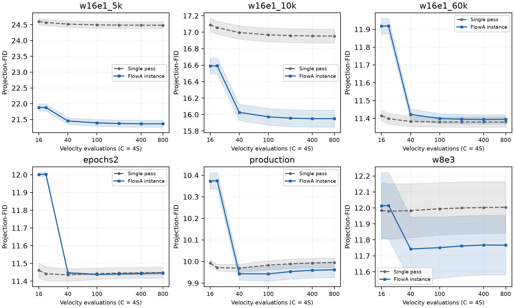
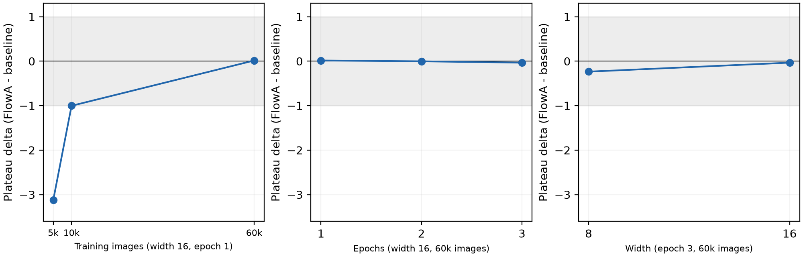

# FlowA：面向冻结流匹配检查点的轮次边界再推理

中文修订稿 v4｜TNNLS Full Paper 写作稿｜2026-11-03

本版根据源代码、六检查点结果及审稿自查表重组。本轮补入已有 β 与轮数敏感性，纠正轮数上限与每轮步数下限的区别，并补齐直接相关文献及指标出处。中文稿用于讨论，正式投稿需完成英文转换、官方模板排版及剩余引文与材料核对。

## 摘要

冻结流匹配检查点的推理通常由从先验到终点的一次积分完成。本文研究在模型参数不变时，如何通过轮次边界上的状态重构改变生成结果。FlowA 将记忆、新先验、重启时间和预算分配组织为可替换的再推理过程。其 MNIST 实验实例采用受限轮数、部分时间区间再积分和最终样本质心保持，调度预算预先确定。我们以六个检查点的匹配积分预算曲线检验该实例：在 w16e1_5k 上，投影特征 Fréchet 指标的平台由 24.4839 降至 21.3632，相对改善 12.75%；其余五个检查点在既定绝对阈值规则下持平。固定架构的数据规模轴、固定数据的训练轮数轴和同训练步数的宽度对照进一步界定了收益范围。经验协方差收缩比与有限样本回归提供家族内描述，固定输入收缩与线性混合恒等式提供有条件的数学解释。已有消融表明质心处理改变均值项但不足以保证所有检查点获益；跨域记录则提供不同协议下的描述性读数与不利结果。结果支持按检查点验证轮次边界干预，并区分算法实例、统计证据与可复用实现。

关键词：流匹配；生成模型；推理时控制；再推理；可复现性。

## I. 引言

流匹配通过拟合随时间变化的速度场，将简单先验输运至数据分布；整流流关注使这种输运更直接的学习过程[1]–[2]。对于已经训练完成的检查点，模型参数固定，但推理协议仍包含若干选择：积分器、时间网格、初值、重启方式与最终输出处理。这些选择共同决定实际生成的样本分布，因此“检查点相同”并不意味着“采样过程相同”。

单次积分的一个限制是，增加数值步数主要改进对既定流映射的近似。当质量随步数趋于稳定时，继续加密同一轨迹并不能保证突破该协议的质量平台。另一方面，改变下一轮初值和积分区间会引入新的状态演化，也可能带来分布偏移或多样性损失。本文的问题是：在冻结检查点和相同模型调用成本下，轮次边界干预能否形成可重复的质量收益，其适用条件是什么？

这一问题与生成过程中的重启采样直接相关。既有 Restart 方法已经把随机扰动与后续 ODE 演化结合起来[3]。本文不把重新注入噪声、重复积分或线性混合本身视为新的概念。我们关注的是一个明确的流匹配再推理实例，以及支持不同实例接入与复核的实现边界。算法的新颖性应由具体操作组合和对照证明，而不能由接口数量或工程检查数量代替。

FlowA 将终点记忆、新先验、重启时间和轮次预算分开。通用实现能够表达多种调度与反馈策略；本文最完整的 MNIST 实证对应其中一个具体实例：总积分预算分摊、累计噪声比例固定、后续轮次从记忆对应时刻积分、输出端保持首轮终点的样本质心。该实验中的调度预算在生成前计算，不能据调度器名称将其称为已验证的在线自适应反馈。本文围绕这一实例组织主结果，再把其他任务作为不同适配条件下的扩展证据。

检查点比较也采用可解释的轴。六个已有检查点覆盖固定架构的一轮训练数据规模变化、固定架构和数据的训练轮数变化，以及相同训练步数下的宽度变化。它们比简单的四点横截面提供更多结构，但仍不等于对速度场误差的直接因果测量。我们同时报告事先假设中未满足的严格单调性条件，避免用一个拟合系数替代完整检验。

本文贡献分为三个层次。第一，给出可执行的轮次边界再推理定义，明确主实验实际使用的初值、时间区间、预算和样本级后处理。第二，以六检查点的匹配预算前沿及受控轴分析界定质量收益，并将经验协方差诊断与条件性数学性质联系但不等同。第三，以清楚区分任务和比较臂的跨域结果，以及可追溯的实现记录，展示该控制面的可复用性。完整前沿优势仍限于一个 MNIST 检查点；跨域点改善不承担普遍加速或普遍质量保证。

## II. 相关工作与评价对象

### A. 单轨迹求解、训练改变与重启

流匹配和整流流提供了学习连续输运的训练框架[1]–[2]。在推理阶段，数值求解器改变对既定动力学的近似方式。以扩散模型的 DPM-Solver 为例，其重点是利用模型方程结构减少求解成本[4]；这与重新构造一个轮次的初值是不同的干预。本文没有在所有模型上复现这些专用求解器，因此这里只比较干预对象，不将设计层面的差异写成数值优越性。

训练阶段的路径改变与蒸馏则作用于检查点本身。整流流的 reflow 重新学习输运，一致性模型学习跨轨迹时刻的映射，以支持少步生成[2],[5]。本文固定速度场，不通过新的训练获得再推理收益。保持权重不变是一项协议约束，不能据此推出对训练或蒸馏方案的总体效率优势，因为总训练成本与部署需求并未在同一实验中比较。

生成过程中的随机性和重启具有更直接的相关性。基于随机微分方程的生成建模统一了不同噪声演化与校正方式[6]；Restart 在额外前向扰动与后续 ODE 采样之间交替[3]。FlowA 的 MNIST 实例采用前一轮终点和新先验的混合，并令混合比例关联重启时间。它还包含特定预算安排和样本质心处理。已有实验隔离了质心平移这一组件，但其累计噪声参数为 0.5，区别于主前沿的 0.3；其他组件尚缺同协议的完整隔离。因此主前沿仍对应完整实例，不能断言某一环节是优势的唯一来源。

| 比较对象 | 主要改变 | 是否改变检查点权重 | 本文能够作出的比较 |
|---|---|---|---|
| 单次流匹配 / 整流流积分 | 从一次先验完成输运 | 推理时不变 | 同检查点的直接基线 |
| 数值求解器 | 单轨迹的离散化与求值安排 | 通常不变 | 操作层次比较，不声称全面优于专用求解器 |
| Reflow / 一致性学习 | 学习路径或映射 | 需要训练相应模型 | 固定权重约束的区别 |
| Restart sampling | 扰动后继续生成演化 | 可用于冻结模型 | 最接近的机制背景，不把重启本身列为首次贡献 |
| 本文 MNIST 实例 | 轮次状态、部分区间、预算与质心 | 不变 | 测量完整配置的检查点条件性结果 |

表 I. 比较对象与本文能够支持的比较层次。

### B. 最接近干预的具体差异

Restart 原文算法在预定噪声区间注入前向扰动，再沿反向 ODE 积分；其扩散模型伪代码按噪声日程设置扰动核，默认示例使用 Heun，但并不限定求解器[3]。本文 MNIST 实例则混合前轮终点与新先验，将混合权重对应到部分流时间，固定总 RK4 调用预算，并加入批次质心保持。操作上的差异不能替代同检查点、同模型调用次数与同评价器的结果比较；当前材料没有这项与原始 Restart 实现的匹配对照。

LineageFlow 原文还提出中间时刻的 rerouting，以变异、选择和扩增后继续流积分[9]。它同样属于冻结参数下的状态干预，须纳入直接相关工作。本文主实例没有运行该选择目标，也没有把框架接口上的反馈能力等同于其选择操作；现有蛋白随机序列基线不能承担与该 rerouting 的公平比较。Kanzi 的流匹配自编码器[10]和 FlowMol3 的连续坐标/离散类别联合生成器[11]则分别规定了表示与状态空间，不能仅因接入了它们就新增一项方法优势。

### C. 质量—计算量前沿

我们把完整方法实例记作 A，将其在检查点 θ、预算 C、种子策略 s 下的质量记为 Q(A,θ,C,s)。比较时固定 θ、样本规模、特征评价器和先验策略。对较低为好的指标，定义 Δ(C)=Q(FlowA,θ,C,s)−Q(base,θ,C,s)。单个负差值只是一个操作点的方向改善，不能单独证明整条前沿占优。

前沿比较使用共同网格，同时检查逐档差值、不确定性和高预算平台。平台定义必须先于结果选择。我们沿用原登记的绝对效应阈值，并保留已有 WIN/TIE 判定；这些标签服务于该实验的决策规则，不是统计等效或所有预算档均无损的同义词。跨模型指标不共享同一个阈值，也不共享一个数值尺度。

### D. 指标与成本的可比性

标准图像 FID 使用特征分布的均值与协方差[7]。本项目 MNIST 实验使用像素的固定高斯随机投影特征，默认从 784 维投影至 128 维，再计算 Fréchet 距离。本文始终称其为 projection-FID；它不是 Inception 特征 FID，也不与其他论文的标准 FID 数字直接比较。CIFAR-10 的 Inception 评价另列。

计算量用两个变量区分：S 表示积分步数，C 表示每样本速度场评估次数。本文已核对的 MNIST NumPy 与 Torch 后端均为四阶段 RK4，故 C=4S。历史文件的 nfe 字段在这些路径上实际表示 S。本文图表以真实函数评估 C 为横轴，并在复现索引保留历史 S 标签。这种统一换算不改变同求解器两臂的预算匹配、平台数值或比率；它也不把质量改善转化为实测墙钟加速。

### E. 数据与跨域指标的来源

主数据为 MNIST[18]，跨域图像记录另含 CIFAR-10[19]。模型检查点、数据集、评价器与评价参考集是不同来源：本文的 MNIST 检查点由项目现有训练流程得到，不是原论文发布权重；projection-FID 的自定义特征不能通过引用 FID 原文变成标准 Inception FID。CIFAR 的历史特征权重与缓存配置也须随结果核对，不能只据“Inception”名称直接对比文献数值。

| 对象 | 实际定义与来源 | 可以支持的含义 |
|---|---|---|
| scPerplexity | ESM-IF[13]对序列在预测骨架条件下的平均非填充 token 负对数似然取指数；实现另有溢出截断 | 序列—预测结构自一致性；不等于实验功能 |
| pLDDT | OmegaFold[12]输出 PDB 中 Cα 原子的置信度字段，按残基去重后求均值 | 模型置信度代理；不是对已知天然结构的误差 |
| 家族命中 | HMMER[15]搜索 Pfam[17]；任意家族命中数与目标家族 top-1 识别分开 | 命中数增加不保证目标家族身份 |
| 新颖性 | MMseqs2[16]相对指定参考库的序列一致性规则；本记录阈值为 30% | 相对该库和该搜索协议的新颖性，不是脱离参考库的属性 |
| Kanzi RMSD | 两臂分别在各自坐标上 encode/decode 后作刚体对齐并求重建误差；坐标单位与 Cα 表示来自适配路径[10] | 自编码重建误差；两臂结构来源不同 |
| 分子有效性 | RDKit 最大连通片段 sanitization；PoseBusters[14]几何/能量检查另列 | 化学可解析性和构象检查分别评价，不互相替代 |

表 II. 指标到来源的对应。FlowMol3 驱动调用 tools.paper_metrics.compute_all_paper_metrics，其 PoseBusters 路径默认尝试注入项目 YAML，再调用上游 analyze；不能将另一独立 helper 中的 xtb 重评逻辑归给这条实际路径。现有汇总未完整保存逐分子 verdict 与成功启用的检查集合，因此不宣称与原论文所有 PoseBusters 设置严格一致。fg_dev 为相对既定训练参考的 REOS 标记率累计偏差，也不与 RMSD 或有效率合并成跨任务统一分数。

## III. 方法与主实验实例

### A. 一般轮次控制

设 vθ 为冻结速度场，Φθ(a→b;Sk) 为在时间区间 [a,b] 上以 Sk 步近似得到的流映射。第 k 轮终点记为 ek，新先验记为 ξk，轮次混合操作为 Bk。一般更新写成：

xk = Bk(ek−1,ξk)，  ek = Φθ(ak→1;Sk)[xk]。                 (1)

首轮从先验开始，a₁=0，不需要先前终点。后续时间起点 ak、混合操作和预算均属于方法定义。式（1）容纳固定与反馈更新策略，但不要求所有实验都使用同一调度器。对于离散类别和图通道，Bk 必须由适配器规定合法操作，不能把线性欧氏插值直接当作已验证方案。

### B. MNIST 的混合与时间对应

MNIST 主实例在连续像素状态上使用终点记忆与新先验的凸混合。设总新噪声参数为 βtot=0.3，总轮数为 R。对于 R>1，每次实际重启使用：

βr = 1−(1−βtot)^(1/(R−1))，  m=1−βr。                 (2)

于是 R−1 次混合中形式上的记忆保留系数乘积为 1−βtot。这个代数关系不代表中间积分后的实际信号或方差也按同一比例保留。四轮时 βr≈0.112096，不能把 0.3 或历史汇总字段中残留的 0.5 直接解释为每轮实际新噪声权重。

新先验来自适配器的高斯采样及像素范围截断。后续轮次以 xk=m ek−1+βr ξk 开始，并在 memory 模式下令 ak=m，只积分 [m,1]。四轮时后续区间起点约为 0.887904。这里的时间对应来自所采用的线性流路径参数化；对于不同状态空间或噪声日程，需要重新确定相应关系，不能默认沿用。

### C. 总预算与低预算轮数

实验的历史预算网格 S∈{4,5,10,25,50,100,200} 对应真实速度场评估 C∈{16,20,40,100,200,400,800}。每个框架臂满足 ΣSk=S，基线也用 S 步 RK4。当前低预算协议采用平均预算参数 h=2，将实际轮数限制为 R=min(4,max(1,⌊S/h⌋))；因此 S=4 和 5 使用两轮，而较高预算通常使用四轮。轮数变化还会改变式（2）的每次混合比例。

参数 h 的历史命名为 min_steps_per_round，但它只限制平均轮次预算，不逐轮强制 Sk≥h。实际分配仍只保证 Sk≥1；例如 production、S=50、R=4 的 evidence_driven 臂分配为 [25,18,6,1]。因此“每轮至少两步”是前稿的错误表述。各轮步数由选定调度器提前提供的权重分配，并使总和精确等于 S。该 MNIST 驱动没有调用运行中的 record_round_feedback；EvidenceDriven 名称不能据此被解释为实验已闭合在线反馈环。通用 runner 具备反馈调用路径，这是实现能力，与当前主结果实际使用的策略分别报告。

### D. 样本质心保持

主实例还启用了 mean_preserve。生成时保留首轮终点集合 E₁，完成所有轮次后得到 ER，然后作批次平移：

xout,i = eR,i − mean(ER) + mean(E₁)。                 (3)

该操作不使用参考测试集，且不额外调用速度场；它使用当前生成批次的均值，因此是总体样本级操作，不是逐样本独立映射。E₁ 对应框架首轮分配到的预算，并非必然等于使用全部预算的单次积分基线。平移改变特征均值而不改变协方差，可能直接影响 Fréchet 类指标。主结果应归于包含该步骤的完整配置，不能全部归于重启或调度。

### E. 可执行流程

| 算法 1：MNIST 主实例 | 操作 |
|---|---|
| 输入 | 冻结检查点；生成种子；样本数 N；总积分步数 S；βtot=0.3；最大轮数 4；平均预算参数 h=2；实际 Sk≥1 |
| 配置 | 确定实际 R、每轮 βr、时间起点及调度权重；分配正整数 Sk，总和为 S |
| 首轮 | 使用与基线共享的先验政策，RK4 积分 [0,1]；保留终点样本及其均值 |
| 后续轮次 | 生成记录键控的新先验；与上一轮终点混合；从 1−βr 积分至 1 |
| 输出处理 | 按式（3）将最终样本均值锚定于首轮终点均值 |
| 计量 | 记录积分步数及换算后的 C=4S；评价开销、后处理和墙钟时间另计 |

共享先验保证比较对象的初始随机政策可对应，但后续重启使用额外随机输入。各臂的随机输入生成方式必须随协议报告。本文没有假定固定种子天然保证任意两条模型路径构成统计意义上的天然配对，也没有将批次质心处理后的 N 个输出视为 N 次独立运行。

### F. 实现边界与跨域适配

通用实现分离调度、策略驱动、合并与重启混合四类接口，模型适配器处理原生状态、冻结模型调用和终点导出。这样可以在不改动上游源码的条件下组织不同控制实例。接口一致性有助于表达和检查过程，但不会自动使不同任务的操作具有相同的统计或数学含义。

本文把跨域实验定位为扩展证据，并按实际比较对象建立对应关系。多轮配置名、适配器存在和评价器实际运行，分别是三种不同事实；只有端点进入下一轮混合并继续求解，才构成本文意义上的端点再推理。

| 单元 | 实际比较与启用路径 | 对本文主机制的支持范围 |
|---|---|---|
| MNIST 主前沿 | 冻结同检查点；端点混合、部分区间 RK4、预定预算、质心保持 | 完整实例的匹配调用比较 |
| MNIST 质心消融 | 同种子、同预算及累计噪声 0.5；质心保持关闭/开启 | 输出一阶矩组件的局部隔离 |
| Kanzi 历史 R2 | 输入坐标直接自编码往返，对比经表示桥生成坐标后的自编码往返 | 两种结构来源的重建读数；不是同输入的迭代优化 |
| LineageFlow R1 / R6 | baseline 为家族氨基酸偏置的随机抽样；framework 经适配器；R6 清单为 nfe=10、请求三轮、重启门槛 20 | live 评价不构成同一学习生成器的匹配采样对照；现存门控路径有效一轮 |
| FlowMol3 历史 R3 | prior 坐标加噪后一次求解；默认不调用全通道混合 | 先验扰动比较，不能证明端点多轮价值 |
| FlowMol3 GAP-39 | 独立标记的全通道 prior 混合后一次求解 | 通道操作对照；不与历史 R3 数值合并 |

表 III. 方法组件到证据的映射。R6 清单未记录生成时源码提交和实际加载模式，当前驱动源码显示 nfe 小于重启门槛时退化为单轮；该限制与两臂生成器不同共同阻止将其解释为主机制的第二条独立验证。评价模型使用真实权重，不会补足生成协议中的这些控制条件。Two Moons、CIFAR 等其他协议仍依各自登记分别解释，不从本表外推它们的实际启用路径。

## IV. 数学性质与经验诊断

### A. 固定映射的条件性收缩

令 E 为欧氏空间中的非空闭凸集，Φ:E→E 为 K-Lipschitz 映射。固定新输入 b∈E、固定记忆比例 m∈[0,1]，令 Gb(x)=Φ(mx+(1−m)b)。若 q=mK<1，则由压缩映射原理，Gb 在 E 上存在唯一固定点 x*b，且：

‖Gb^k(x)−x*b‖ ≤ q^k‖x−x*b‖。                 (4)

证明只需注意 ‖Gb(x)−Gb(y)‖≤Km‖x−y‖，以及 E 完备且 Gb 自映射。该结论是经典收缩原理在此复合映射上的应用，不单独承担新理论贡献。若以数值流映射代替精确流映射，必须对实际数值映射给出对应的稳定性条件，不能直接借用原 ODE 的常数。

主实验逐轮换新先验，并随预算改变轮数、每轮比例和积分安排；输出端还含式（3）的批次平移。因此式（4）不是其完整收敛证明。对于固定 q 下的新输入扰动，可以写出 dk≤qdk−1+K(1−m)‖bk−b′k‖；这说明持续输入会持续施加扰动，而不自动导向同一固定点或目标数据分布。

### B. 混合误差的精确分解

设 X、Y 平方可积，z 为固定参考状态，m 为固定比例，Bm=mX+(1−m)Y，则不要求独立性就有：

E‖Bm−z‖² = mE‖X−z‖²+(1−m)E‖Y−z‖²−m(1−m)E‖X−Y‖²。                 (5)

这是展开平方后整理得到的凸组合恒等式。对 m<1，相对 X 的严格改善当且仅当 E‖Y−z‖²−E‖X−z‖²<mE‖X−Y‖²。该式刻画混合当下的状态误差，不包含后续非线性流映射，也不包含输出批次平移，因此不能直接解释整个主实例的 FID 变化。

### C. 经验 κ 与性质分析的区别

已有诊断在投影特征空间计算 κ=tr(Σframework)/tr(Σbaseline)。实现中使用参考协方差与 baseline dispersion 的乘积作等价归一化。κ 是两组已生成样本的经验分布离散度比；它不是式（4）的 mK，也不是未运行框架臂时即可得到的性能预测器。协方差迹缩小可能有益，也可能代表多样性损失，其含义取决于基线相对参考分布的位置。

四个原始检查点的 κ 记录依次约为 0.6666、0.7384、0.8931 和 0.9585，对应平台差值约为 −3.1206、−1.0036、+0.0150 和 −0.0335。记录中的 κ 在历史 S=50 下测量，平台在 S=100/200 下汇总，且 κ 汇总了多个比较臂；不能把这张表当作严格同臂、同预算的因果桥梁。它提供家族内的探索性描述，不确定统一阈值，更不把协方差收缩定理化为图像质量保证。

## V. 数据、协议与统计

### A. 六检查点的受控轴

| 检查点 | 基础宽度 | 训练图像数 | Epoch | 优化步数 | 用于分析的轴 |
|---|---:|---:|---:|---:|---|
| w16e1_5k | 16 | 5000 | 1 | 78 | 固定宽度与 epoch 的数据规模轴 |
| w16e1_10k | 16 | 10000 | 1 | 156 | 同上 |
| w16e1_60k | 16 | 60000 | 1 | 937 | 数据规模轴与 epoch 轴交点 |
| epochs2 | 16 | 60000 | 2 | 1874 | 固定宽度与数据的 epoch 轴 |
| production | 16 | 60000 | 3 | 2811 | 同上；也是宽度对照 |
| w8e3 | 8 | 60000 | 3 | 2811 | 同数据、epoch 和优化步数的宽度对照 |

表 IV. 六检查点的训练配置与分析轴。

数据规模轴同时改变可见训练样本和一轮训练所需优化步数，故不是纯粹隔离优化步数的实验。epoch 轴固定架构和数据，能够比较训练延长后的检查点，但没有多个独立训练种子来支持广泛因果推断。本文按这两条轴分别分析，而不将全部五个优化步数水平包装成一个无混杂的单因素实验。

### B. 采样、前沿与阈值

每臂每种子 N=1000，生成种子固定为 42、43、44，主比较臂为 evidence_driven 对应的预定预算实例。四个原检查点来自 NumPy 路径；新增检查点的完整网格主要来自 Torch float64 路径，最低两档的轮数限制修正来自 CPU 重算。后端一致性有既有数值核对记录，但跨后端相符不等于环境任意变化都逐字节一致。

主表使用最低两档已应用h=2 轮数限制的当前前沿；不能用未限制的低预算 LOSS 与限制后的其他检查点构成一个混合比较。平台取历史步数 S=100 与 200 的均值，真实速度场调用为 C=400 与 800。前沿判定沿用绝对效应阈值 1 个 projection-FID 单位，并将相对 1% 规则的不同结果作为敏感性而非择优结论。

### C. 统计单位与解释

主曲线的汇总单位是三个生成种子，而非每个种子中的一千张图像。配对自举区间只有三个种子提供的差值信息；重采样一万次不会产生新的独立重复。本文将其作为当前三种子条件下的区间描述，区分区间是否排除零与是否超过实际效应阈值。

不同预算档共享检查点和种子，不能把七档曲线视为七个独立验证任务。四检查点回归只有四个观察点，含截距和斜率后残差自由度为 2，双侧 95% 区间应使用 t0.975,2≈4.302653[8]。此前工具误用了 2.776，本版以修正区间报告，点估计和原始样本不变。

跨域统计遵循各单元原有设计。记录匹配、合成结构变体、家族聚类和独立种子的单位应分别列出；Kanzi 的逐记录文件本轮从历史版本恢复后，分别复算旧索引差值与 Welch 敏感性；这不使其合成变体成为独立天然结构。其他缺少逐记录文件的单元仍不标为已独立复算。工程完整性检查仅验证文件和引用关系，不能替代这一统计核查。

## VI. 结果

### A. 匹配预算前沿与质量平台

图 1. 六检查点前沿。横轴为真实速度场评估次数 C=4S，纵轴为 projection-FID；线条表示三种子均值，阴影表示种子间一个标准差，不是均值的 95% 置信区间。所有点均来自已记录的规范化输入，不补插未测档位。最低两档使用当前轮数限制协议。

| 检查点 | 基线平台 | 框架平台 | 差值 | 相对变化 | 绝对阈值判定 |
|---|---:|---:|---:|---:|---|
| w16e1_5k | 24.4839 | 21.3632 | −3.1206 | −12.75% | WIN |
| w16e1_10k | 16.9537 | 15.9501 | −1.0036 | −5.92% | TIE |
| w16e1_60k | 11.3795 | 11.3945 | +0.0150 | +0.13% | TIE |
| epochs2 | 11.4478 | 11.4441 | −0.0037 | −0.03% | TIE |
| production | 9.9938 | 9.9603 | −0.0335 | −0.34% | TIE |
| w8e3 | 12.0032 | 11.7672 | −0.2360 | −1.97% | TIE |

表 V. 平台为历史 S=100/200 的均值，对应真实 C=400/800。当前绝对规则为 1 WIN、5 TIE。数值按同一检查点的源文件计算，四舍五入不改变既有判定。

w16e1_5k 的七档曲线满足当前优势规则，平台改善 3.1206，是本稿最完整的正向结果。w16e1_10k 的点估计改善约 1.0036，但对应改善区间下界约 0.984，未越过 1 单位阈值，因此不能将该行转写成同等强度的优势。另四个检查点的平台变化都在该阈值内。

低预算约束本身也是方法的一部分。epochs2 在未限制四轮的最小预算档曾出现 +2.8603 的不利差值；使用两轮限制后为 +0.5408。下一档限制后反而比未限制版本更差。此现象说明预算、轮数和每轮重启比例存在联动；当前 TIE 不是“所有预算都改善”的简写。w8e3 在相对阈值和绝对阈值下的结论也可能不同，本文以预先采用的绝对规则为主，不选取更有利标签。

### B. 数据规模、训练延长与宽度

图 2. 三种检查点对照。左：固定宽度 16、一个 epoch 的数据规模轴；中：宽度 16、60000 张训练图像的 epoch 轴；右：60000 张图像、三个 epoch、2811 优化步数下的宽度对照。纵轴为框架减基线的平台差值，阴影标出 ±1 指标单位的范围。此图显示测得关联，不附加未测的训练种子不确定性。

数据规模从 5000 增至 10000 再至 60000 时，平台改善明显减小。固定 60000 张图像延长训练的三个检查点则都在绝对阈值内。相同 2811 优化步数下，宽度 8 与 16 的改善分别约为 0.2360 和 0.0335，说明优化步数本身并不能唯一确定收益。基线质量、表示容量和训练过程仍可能共同参与。

预注册的严格单调改善衰减条件并未全部满足：在接近零改善的部分，差值发生小幅反向变化。应报告“有限检查点上的收益减小并进入阈值内区域”，而不是一个已经识别的普适单调规律。数据轴和 epoch 轴为当前家族的解释提供结构，尚不能将结果外推为所有流模型的训练充分性定律。

### C. 家族内描述性回归

在四个原检查点上拟合框架平台对基线平台，得到 y≈2.411865+0.780448x，R²≈0.99758。把后续两个检查点排除在拟合外，epochs2 和 w8e3 的点预测误差分别约为 −0.0978 和 +0.0126，平均绝对误差约为 0.0552。这个分析展示了同一检查点家族中较紧的描述性关系，但不是事前锁定的预测实验。

| 拟合外检查点 | 实测框架平台 | 点预测 | 修正后的 95% 预测区间 |
|---|---:|---:|---|
| epochs2 | 11.4441 | 11.3463 | [9.774, 12.918] |
| w8e3 | 11.7672 | 11.7797 | [10.227, 13.332] |

表 VI. 使用四点拟合、残差自由度 2 的结果。修正 t 临界值后，斜率 95% 区间为 [0.6635,0.8974]；历史较窄区间不沿用。两拟合外基线均位于训练范围内，因此是家族内插值核查；宽预测区间说明点误差小不代表识别分辨率高。

六点拟合与留一法同样只能作为家族内分析。留一法的每一折确实排除了该折评价点，不能称为训练集内误差；但模型形式和评价家族没有独立改变，因此也不能视为跨家族验证。缺少另一模型家族的可用前沿时，不能将该关系写成可推广的性能预测器。

### D. 已有质心消融的复算

为区分输出平移与重启的作用，我们重新读取已有 GAP-76 / GAP-57 生成样本，用现有评价器复算 4 检查点 × 3 调度臂 × 3 种子的 36 个比较。这里不重新采样。协议为每臂 N=1000、S=50（MNIST RK4 对应 C=200）、R=4、memory 起点和累计噪声 βtot=0.5。它不同于主前沿的 βtot=0.3，不能据其配置名认定逐轮至少两步，因此不把两组数据接成一条曲线。

| 检查点 | 关闭质心保持的 Δ | 开启后的 Δ | 开启后均值的 95% t 区间 |
|---|---:|---:|---|
| w16e1_5k | +0.061 | −3.215 | [−3.270, −3.161] |
| w16e1_10k | +1.271 | −0.738 | [−0.792, −0.684] |
| w16e1_60k | +1.806 | +0.340 | [+0.289, +0.392] |
| production | +1.033 | +0.109 | [+0.039, +0.178] |

表 VII. evidence_driven 臂的三种子均值，Δ 为同种子框架减基线的 projection-FID。区间为三次生成运行的 t 区间、自由度 2；不是一千张样本级区间，亦未对 12 个检查点—调度臂比较作同时覆盖校正。

全部 36 个比较的协方差迹和 Fréchet 交叉项在数值容差内保持一致，最大差分别约 7.1×10⁻¹⁵ 与 7.8×10⁻¹⁴；这与平移只改变均值项的数学性质吻合。输出质心相对对应基线的距离由 0.787–1.972 降至 0.0037–0.0152。预先提出的“seed42 至少 8/12 单元 Δ≤0”条件没有满足，实测仅 6/12，总计 18/36。

这项隔离支持质心漂移是该协议下可测的一条损失通道。它不能证明质心保持对所有检查点都改善到基线以下：按三种子区间是否排除零，开启后 12 个单元为 6 个有利、6 个不利；按均值绝对值小于 1 的描述性阈值则为 3 个改善、9 个阈值内变化。后一规则只看该消融的平均差，不等同于主前沿包含区间和多预算要求的优势判定。βtot=0.3 下各组件的完整矩阵仍缺失。

### E. β 与轮数的已有敏感性

在 production 检查点上，已有 β 扫描每臂 N=1000、种子 42/43/44、R=4、memory 起点及质心保持；本轮从 24 个既有运行汇总重算。固定 S=50 对应 C=200，所示区间以三个生成种子为单位。平台仅在 β=0.15 与 0.70 新测 S=100/200，β=0.30 复用主前沿，β=0.50 平台未测。

| βtot | C=200 的 Δ | 该均值的 95% t 区间 | C=400/800 平台平均 Δ |
|---|---:|---|---:|
| 0.15 | -0.0240 | [-0.0588, +0.0107] | -0.0221 |
| 0.30 | -0.0364 | [-0.0721, -0.0008] | −0.0335（原前沿） |
| 0.50 | +0.1086 | [+0.0390, +0.1783] | 未测 |
| 0.70 | +0.5729 | [+0.4468, +0.6990] | +0.5763 |

表 VIII. evidence_driven 臂。所有区间未作同时覆盖校正；平台以同种子两预算的差值均值计算。β=0.50 的空格不能由 C=200 结果补填，也不能写成所有 β 在平台上都已测试。

更大 β 没有在已测 production 单元带来超过 1 单位的改善，β=0.70 反而使均值升高约 0.5763。β=0.30 是此有限网格的 C=200 最优均值；这既不证明连续范围上的全局最优，也不独立证实协方差诊断的因果解释。已核对旧报告：−0.3648 来自 headline_mean 的百分比口径（−0.3648%），对应 delta_units_mean=−0.0364203 指标单位；旧审计将前者标作 ΔFID，造成约十倍的表面差异。本文采用绝对单位列示，原报告与本轮复算的绝对读数一致。

固定 S=25（C=100）、βtot=0.3 的轮数扫描还覆盖 R=2/4/6/8/12、三个种子，共 15 次已有运行。evidence_driven 臂的平均 Δ 依次为 +0.1494、−0.0407、−0.0634、−0.0642、−0.0296。R≥4 的该臂变化跨度约 0.0346，远小于 1 单位；更多轮数没有在这个检查点上形成实用阈值以上的收益。轮数变化还联动每次重启比例与步数分配，故不能视为只改变迭代次数的纯消融。记录中的 h=2 仍只限制轮数，R=12 的某些分配有一步轮次，与实际实现相符。

这两组扫描只覆盖 production，不能用于解释获益最大的 w16e1_5k 上所有 β 或组件。它们补充的是已测参数范围与未测格子的边界，而非普适的参数最优性。

### F. 跨域点结果及统计边界

LineageFlow k6 的 live scPerplexity 评价使用种子 42、43、44，每种子 1000 条记录，种子内按 qid 对应。as-designed 框架的合并均值由 17.8893 降至 14.2071，平均差 −3.6823，索引差值 dz=−0.8393，三个种子和各难度层方向一致。困难层 pLDDT 的 dz=+1.1211 对应 n=990；均匀预算版本的总体 pLDDT dz=+0.1466。不同臂、总体与困难层分别报告，不使用旧反事实代理作为 live 结论。

这些读数来自实际评价，但 baseline 是家族偏置随机序列，不是冻结生成器的标准单次采样；相同 qid 也不代表同一条序列的前后处理。R6 生成清单与当前门控代码还提示请求三轮在该低预算下有效一轮，且未记录历史生成源码提交与加载模式。因此，这组结果作为不同生成流程的描述性对照保留，不能支撑“端点多轮再推理在蛋白领域也获益”。scPerplexity 是自一致性指标，pLDDT 是预测置信度；二者不证明蛋白功能或天然结构正确性。合并 3000 条记录亦不代替独立家族与训练重复。

Kanzi 的原 baseline 文件现已从提交 0d070700 的 Git 对象逐字节恢复；与现有 framework 文件各含 1000 个 RMSD 记录。复算均值为 0.902763 Å 和 0.883799 Å，差 −0.018964 Å。历史按索引差值的检验可准确重现：p=0.001794、dz=−0.0990；这只是历史计算的复现，不意味着同输入天然配对成立。

作为独立记录假设下的敏感性分析，Welch 检验给出 SE=0.006201 Å、df≈1996.87、p=0.002254、95% 区间 [−0.031124,−0.006804] Å。沿历史七个 R 级比较的 Bonferroni 家族，校正 p≈0.01578。该家族不包括后续调参与全部指标，不能用于确认所有探索性选择。两臂索引相关约 0.0456，源码显示 baseline 测量输入坐标的自编码往返，framework 测量经表示桥生成坐标的自编码往返；二者并非同输入的优化前后比较。

baseline 的 1000 个输入仅由四个演示 PDB 各加扰动形成 250 个变体。Welch 数字依赖记录独立假设，不能解释为对天然结构总体或新模板的推断。较低重建误差可能部分反映生成结构更容易被该自编码器重建，尚不能归因为相同结构的质量改善。原始文件恢复补足了统计复算层，不改变这一实验设计边界。

### G. 条件、未显著与不利结果

CIFAR-10 的 N=1000、seed42、单轮历史 NFE=50 协议中，基线 Inception FID 为 48.4059，EvidenceDriven 和 FreeTraj 为 48.1669、48.2522，Cosine 和 CodimensionSheet 为 48.5668、48.6594。两个臂方向改善、两个方向退化，没有该读数的置信区间。该任务的历史预算命名不自动套用 MNIST 的四倍换算，仍需按其实际求解器单独核对。多轮与不同样本量的读数分列，不拼成统一轮数定律。

Two Moons 的真实 aligned-record 重启路径覆盖十个种子 42–51，每臂每种子 N=1000，W₂ 从基线约 0.078279 变为 0.084392，差值 +0.006113，跨种子 p≈0.2873，当前为 TIE。FlowMol3 片段偏差的每臂 N=1000、三种子比较为跨种子差约 −0.03769，区间 [−0.2709,+0.1956]，p≈0.5589，不能主张可靠改善。该历史臂使用 prior 坐标加噪。另有 GAP-39 全通道 prior 混合的独立对照，片段偏差均值差约 −0.05476、p≈0.598；PoseBusters 有效性差约 +0.1410、p≈0.252，也未显著。它是一次求解前的状态混合，不能写成多轮端点重启的获益。RDKit 可解析性与 PoseBusters 几何有效性分别报告；缺失的逐分子 verdict 不作事后补写。

LineageFlow HMMER 的单种子命中数从 158 增至 275，并不代表目标家族身份同时改善。相对于固定 Pfam-A 数据库，在 30% 序列一致性阈值下，新颖样本比例由 466/1000 降至 37/1000。这个负结果表明质量代理轴与新颖性可能发生权衡，不能通过增加接口或强调复现完整性消除。

| 证据类别 | 任务 / 单元 | 本文中的地位 |
|---|---|---|
| 完整前沿 | MNIST R5c，六检查点 | 一个检查点优势，其余当前绝对规则持平 |
| 不同生成器的 live 评价 | LineageFlow k6 R6 | 描述性代理读数；随机序列基线与低预算门控限制机制归因 |
| 已恢复并复算 | Kanzi R2 | 两种来源结构的重建误差差异；不是同输入细化 |
| 协议条件结果 | CIFAR R5b、HMMER R1 | 比较臂、轮数、家族和种子范围明确限定 |
| 未显著 / 持平 | FlowMol3 R3、Two Moons R5a、K1/K5 | 不写成可靠质量改善 |
| 补充收集 / 不利结果 | K4、K7 | 指标收集与新颖性下降公开保留 |

表 IX. 各单元在当前论证中的地位。

## VII. 讨论

### A. 轮次控制的实用含义

本文显示，在一个已记录的较弱 MNIST 检查点上，改变轮次边界的完整协议能够降低原单次积分的质量平台。收益不是通过重新训练获得，也不是由更多 RK4 调用造成；两臂总调用匹配。然而，主实例同时包含重启、时间区间、预算和质心处理，已有 βtot=0.5 消融隔离了质心平移；主前沿 βtot=0.3 仍缺逐组件矩阵。实际贡献应表述为完整配置的可测效果和适用范围。

对已经进入较低平台区域的检查点，同一操作多数落入绝对阈值内。仅据此建议所有部署增加轮数是不合理的。适合的决策应结合当前检查点、预算和可接受指标变化；若没有该检查点的证据，应将其作为待验证配置。当前也没有实测普遍加速，文中的平台收益与部署时延属于不同问题。

### B. 理论、诊断与机制归因

条件性收缩给出固定映射的稳定性变量，混合恒等式提供状态级分解，经验 κ 则描述输出特征协方差。三个对象并不相同。尤其是批次平移直接作用于 Fréchet 距离的均值项，说明若只讨论“残差被再推理修正”，会遗漏一个指标上明确可见的路径。

一个合理但尚未充分识别的解释是，完整干预改变了终点分布的位置和离散度，而这些变化的收益依赖基线处于何种区域。证明某个组件必要，需要同协议的关闭/启用对照；证明速度场残差是因果变量，则需要相应观测与控制。本文使用已有消融记录界定这些问题，不把未测因果解释变成主结论。

### C. 证据范围与复现材料

三个生成种子、六个有限检查点和代理质量指标限制了外部有效性。六点关系仍来自一个模型家族，跨家族前沿缺口没有被源码阅读自动补足。Kanzi 历史文件的恢复使旧统计可以重算，但两臂结构来源与四模板依赖仍限制推断。蛋白 live 评价的随机序列基线同样说明，评价器真实运行并不等于比较设计足以验证主机制。

新增的规范化六检查点输入与前沿文件使主图、平台汇总和修正回归能够从版本控制中的材料重建；它们不是对未发布权重、原始样本和全部环境的替代。复现说明应明确能重建的是哪一层：表图重算、统计重算、样本重生成或上游模型再现。不同层次不得混称“完全可复现”。

### D. 仍需处理的写作与研究项

本版先完成源码可确认的操作定义、成本命名与区间修正。尚未闭合的是：最接近重启方法的同配置数值对照、主前沿参数下质心处理及其他组件的完整归因、Kanzi 的同输入或同生成器控制、蛋白模型匹配基线、跨家族有效性，以及原运行依赖版本与检查配置的完整归属。它们保留在自查表中，按现有记录优先核对；不自动转成新的长时采样任务。

## VIII. 结论

FlowA 将冻结检查点的轮次边界操作显式组织为状态混合、重启时间、积分预算和输出处理。六检查点实证显示，该 MNIST 实例在一个检查点上降低匹配预算质量平台，在其他检查点上呈现阈值内变化。受控检查点轴、经验协方差比和修正后的家族内回归进一步描述了收益范围。数学性质、跨域点结果和负结果共同限定了证据强度。本文的价值在于一个可明确执行、可检查且具有适用边界的推理干预，而非对普遍质量提升或加速的保证。

## 参考文献

[1] Y. Lipman et al., “Flow Matching for Generative Modeling,” ICLR, 2023. https://arxiv.org/abs/2210.02747

[2] X. Liu, C. Gong, and Q. Liu, “Flow Straight and Fast: Learning to Generate and Transfer Data with Rectified Flow,” ICLR, 2023. https://arxiv.org/abs/2209.03003

[3] Y. Xu et al., “Restart Sampling for Improving Generative Processes,” NeurIPS, 2023. https://arxiv.org/abs/2306.14878

[4] C. Lu et al., “DPM-Solver: A Fast ODE Solver for Diffusion Probabilistic Model Sampling in Around 10 Steps,” NeurIPS, 2022. https://arxiv.org/abs/2206.00927

[5] Y. Song et al., “Consistency Models,” ICML, 2023. https://arxiv.org/abs/2303.01469

[6] Y. Song et al., “Score-Based Generative Modeling through Stochastic Differential Equations,” ICLR, 2021. https://arxiv.org/abs/2011.13456

[7] M. Heusel et al., “GANs Trained by a Two Time-Scale Update Rule Converge to a Local Nash Equilibrium,” NeurIPS, 2017. https://arxiv.org/abs/1706.08500

[8] NIST/SEMATECH, “Critical Values of the Student’s-t Distribution,” e-Handbook of Statistical Methods. https://itl.nist.gov/div898/handbook/eda/section3/eda3672.htm

[9] L. Liang et al., “LineageFlow: Flow Matching for High-Fidelity Family-Aware Protein Sequence Generation,” ICML, 2026; arXiv:2605.22252v2. https://arxiv.org/abs/2605.22252v2

[10] R. Dilip, E. Zhang, A. Varshney, and D. Van Valen, “Flow Autoencoders are Effective Protein Tokenizers,” arXiv:2510.00351, 2025. https://arxiv.org/abs/2510.00351

[11] I. Dunn and D. R. Koes, “FlowMol3: Flow Matching for 3D De Novo Small-Molecule Generation,” arXiv:2508.12629, 2025. https://arxiv.org/abs/2508.12629

[12] R. Wu et al., “High-resolution de novo structure prediction from primary sequence,” bioRxiv, 2022, doi:10.1101/2022.07.21.500999. https://github.com/HeliXonProtein/OmegaFold

[13] C. Hsu et al., “Learning inverse folding from millions of predicted structures,” ICML, PMLR 162, pp. 8946–8970, 2022. https://proceedings.mlr.press/v162/hsu22a.html

[14] M. Buttenschoen, G. M. Morris, and C. M. Deane, “PoseBusters: AI-based docking methods fail to generate physically valid poses or generalise to novel sequences,” Chemical Science, 2024, doi:10.1039/D3SC04185A. https://pubs.rsc.org/en/content/articlelanding/2024/sc/d3sc04185a

[15] S. R. Eddy, “Accelerated Profile HMM Searches,” PLoS Computational Biology, vol. 7, no. 10, e1002195, 2011. https://journals.plos.org/ploscompbiol/article?id=10.1371/journal.pcbi.1002195

[16] M. Steinegger and J. Söding, “MMseqs2 enables sensitive protein sequence searching for the analysis of massive data sets,” Nature Biotechnology, 2017, doi:10.1038/nbt.3988. https://www.nature.com/articles/nbt.3988

[17] J. Mistry et al., “Pfam: The protein families database in 2021,” Nucleic Acids Research, vol. 49, no. D1, pp. D412–D419, 2021. https://academic.oup.com/nar/article/49/D1/D412/5943818

[18] Y. LeCun, L. Bottou, Y. Bengio, and P. Haffner, “Gradient-based learning applied to document recognition,” Proceedings of the IEEE, vol. 86, no. 11, pp. 2278–2324, 1998. https://bottou.org/papers/lecun-98h

[19] A. Krizhevsky, “Learning Multiple Layers of Features from Tiny Images,” University of Toronto, Technical Report, 2009. https://www.cs.toronto.edu/~kriz/learning-features-2009-TR.pdf

## 内部复现索引（正式投稿前移入匿名补充材料）

本版对应源码审计记录 docs/audit/manuscript-selfcheck-round3-2026-11-03.md，基准提交为 b6bb14518dbf2eb8085ecf7c26fc85bee0d2e982。科学数据不由文字修订重写。

MNIST 的四原检查点数据来自 verification_outputs/gap84-cap-frontier/ 下的 frontier_input 与 frontier JSON；epochs2、w8e3 的当前低档限制版本来自 verification_outputs/gap90-optsteps-dose-cap/。已有文档 docs/audit/gap90-optsteps-dose.md 记录训练配置、后端、原始与修正档位及未满足的预注册条件。每臂 N=1000，生成种子 42/43/44；原网格主要为 CPU NumPy，新增网格为 Torch float64/cuda:0，最低档修正为 CPU。各图与正文以各自来源的同一配置读数为单位。

两条实现路径对应 scripts/wave191_p3_mnist_sweep.py、adaptive_reflow/adapters/mnist_fm.py 和 adaptive_reflow/adapters/mnist_fm_torch.py。回归复算命令为 python3 tools/gap91_holdout.py；四点预测区间使用已修正的 df=2 临界值。首轮质心操作和预先确定调度是当前实例定义，不以通用 runner 的可选反馈能力替代。

蛋白 live 结果对应 verification_outputs/gap31-r6-live-uplift/gap31_summary.json 及其审计；CIFAR 对应 verification_outputs/wave247-p3-r5b-n1000-n1/summary.json；Kanzi 使用恢复的 verification_outputs/wave218-p3-kanzi-baseline-n1000/kanzi_n1000_paper_metrics.json 与 wave214 framework 原始记录，新复算和来源 SHA-256 记录于 verification_outputs/manuscript-selfcheck-round2-2026-11-02/；Two Moons 与其他单元的协议、种子及环境由 docs/PAPER-EVIDENCE.md 所指文件给出。后续独立统计复核不覆盖或替换历史文件。

本中文稿由 OpenAI Codex 协助进行源码核对、文字组织、绘图和派生区间修订。正式投稿须按期刊规则披露实际保留的生成文本与所用系统；作者需逐条核查并承担最终责任。本版补充主要上游模型、指标与数据的原始文献；历史运行依赖版本与若干评价配置仍未完全固定，不能作为已完成投稿包。

质心消融复算命令为 PYTHONPATH=. OPENBLAS_NUM_THREADS=1 python3 tools/gap76_report.py --out verification_outputs/manuscript-selfcheck-round2-2026-11-02/mean_preserve_recomputed.json。该步骤读取既有 NPZ 样本，不重新采样；本轮纳入 Git 的汇总支持表格复算，完整 NPZ 仍需现有服务器数据。Kanzi 统计由 tools/review_kanzi_statistics_20261102.py 重建；其数值不覆盖历史汇总。

β/轮数敏感性来自 verification_outputs/gap93-beta-dose/ 与 gap84c-round-dose/，本轮重算输出在 verification_outputs/manuscript-selfcheck-round3-2026-11-03/sensitivity.json。工具使用每种子整批 headline 指标，不使用 chunk 最小p值；缺失格子保留未测。新增文献核对入口为 docs/audit/manuscript-literature-ledger-2026-11-03.md。

复现环境补充：本轮工程逐字节回归在限制BLAS/OpenMP线程时出现一项哈希差异，恢复原环境后通过。该检查的范围不延伸为任意线程/依赖环境下的逐字节生成保证；原始失败与复核记录一并保留。
